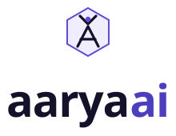

<p align="center"></p>

# Role Prep

Interview practice for AI roles. Answer out loud at your level (Tech, Tech Lead
or Leadership), see exactly what you missed in your own words, and try again
until you're ready. Live at [aaryaai.dev/roleprep](https://aaryaai.dev/roleprep).

This repo holds the practice content and the agent kit that creates it.

## Content

```
content/roleprep/
├── catalog.json                       12 topics, levels, moment kinds, changelog
└── topics/<topic>/
    ├── index.json                     sub-topics, planned or live
    └── <subtopic>.json                ordered interview moments, each at three levels
```

Each sub-topic is a short interview: a "know this cold" opener, interview
questions, an interviewer pushback and a scenario challenge. Every moment has a
separate question, strong answer, rubric and follow-ups for each level.

Live today: **RAG & retrieval: Hybrid search & reranking**. The other 42
sub-topics are planned.

## Agent kit

Built with Claude Code's own building blocks: subagents, Agent Skills, slash
commands and hooks. Open the repo in Claude Code and run, for example:

```
/new-subtopic rag "Chunking & indexing"
```

`roleprep-lead` plans the moments, `roleprep-writer` writes them,
`rubric-reviewer` checks them blind, hooks validate every write, and
`appsec-engineer` gates the change. See [CLAUDE.md](CLAUDE.md) for every agent,
skill and command.

### Use the kit in another project

```
/plugin marketplace add ajeetchouksey/ajch_role_prep
/plugin install roleprep-kit@aaryaai-roleprep
```

## Checks

```bash
npm run check     # structure, editorial rules and pushback giveaways
```

## Contributing

Content changes go through `/new-subtopic` or `/review`, then `/release`. A
change needs a `rubric-reviewer` PASS, clean validators and an AppSec PASS
before it is merged. After merge, the content is promoted from `ajch_platform`.
