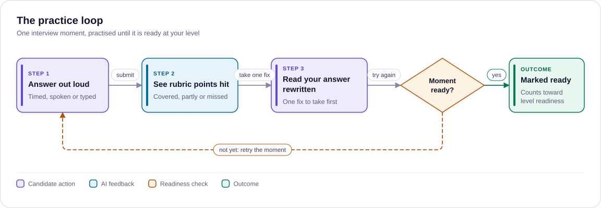
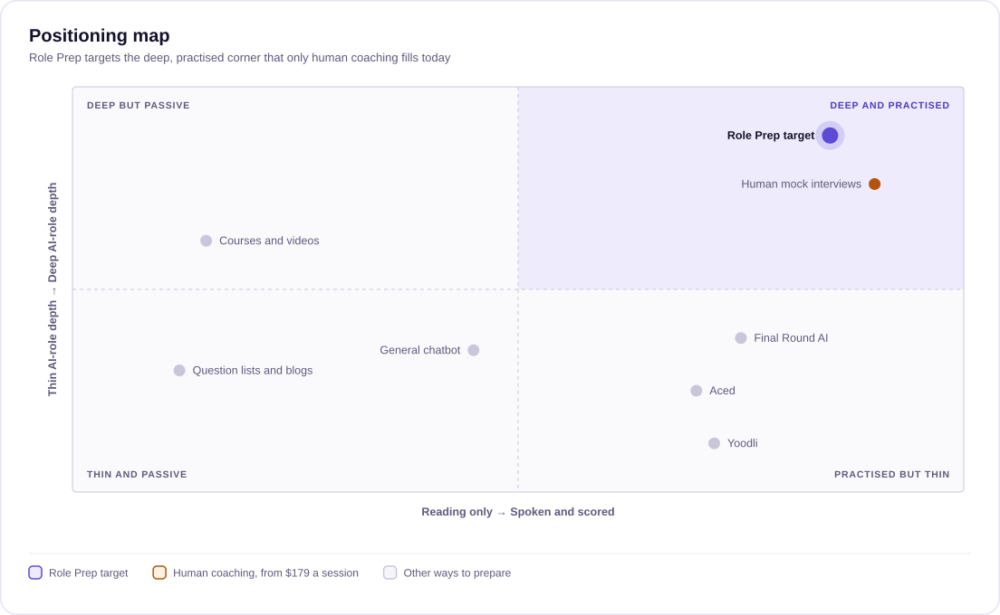
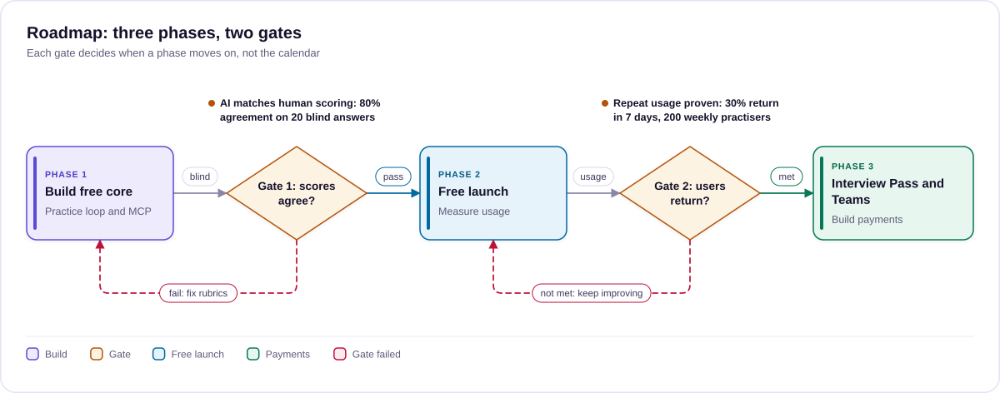

# Business case and value proposition

> Why Role Prep should be rebuilt as a speak-out-loud interview practice product for AI roles, who it serves, and why it wins; for the person approving phase 1.
>
> Status: Draft · Updated: 2026-11-03 · Owner: Ajeet Chouksey
> Next: [02 Use cases](02-use-cases.md)

## Summary

**Recommendation:** rebuild Role Prep as a speak-out-loud interview practice product for AI roles, launch it free, and add a paid Pro tier once usage proves people come back.

**Why it can win, in three lines:**

1. **The need is growing fast.** US postings mentioning generative AI went from 16,000 to over 66,000 in a year. Few candidates have rehearsed these interviews before.
2. **The bar for each level is the gap.** Plenty of tools offer an AI interviewer with one bar for everyone. Role Prep is the only one checked that sets a separate bar for Tech, Tech Lead and Leadership, in AI-role depth.
3. **Work inside the user's AI, don't fight it.** The real substitute is a chatbot. Through MCP, Role Prep supplies that chatbot with the rubrics, so reach costs us almost nothing.

**Honest scale:** individual passes make this a profitable side line, about $1,600 a month in the base case. The larger value is Teams seats and new users for SkillUp and HOL Labs.

Today Role Prep is a reading list: 3 job-ad packs and 11 questions. The rebuild turns it into practice. You answer out loud, get scored against the rubric for your interview level (Tech, Tech Lead or Leadership), see your own answer rewritten, and try again.

Two choices keep it cheap to run:

- **Bring your own AI.** An MCP server lets people practise inside Claude, ChatGPT, Copilot or Cursor, on their own subscription. Our cost there is serving content.
- **Free-tier speech.** Transcription runs on Cloudflare Workers AI, inside the free daily allowance we already use, with per-user caps.

**Decision asked:** approve phase 1. That covers the new content structure for 2 topics, speak-your-answer, AI feedback and a read-only MCP server. Pricing waits until phase 1 shows real repeat usage.

## Problem and who it is for

People interviewing for AI roles can find plenty to read, but almost nowhere to rehearse an answer at the level they are interviewing for and get told what was missing.

The same question is judged differently at each level. "When would you add a reranker?" is a diagnosis question for an engineer. For a tech lead it is a decision-process question, and for a director it is a cost-and-risk question. Generic prep sites and question banks give one answer to all three. Most candidates also practise by reading, and then answer out loud for the first time in the real interview.

| Audience | What they are preparing for | What they struggle with |
| --- | --- | --- |
| Tech: engineers moving into AI | AI or GenAI engineer interviews: RAG, agents, evals, system design | Knowing the concepts but not structuring a 2-minute answer under pressure |
| Tech Lead: senior and staff engineers, architects | Lead or architect interviews | Moving from "how it works" to trade-offs, team decisions and owning outcomes |
| Leadership: heads of AI, engineering and product leaders | Director or head-of interviews and executive panels | Talking about AI in terms of impact, risk, cost and measurement, without jargon |

All three are adults paying for their own career move, often with an interview date in the next few weeks. That urgency is what makes a practice product worth paying for.

## Why now

Three shifts have landed at once. Demand for AI skills is climbing fast, AI interviews now test new material that most people have never been asked about, and AI apps can now connect to outside practice tools.

**1. Demand for AI skills is rising faster than people can prepare.**

| Signal (US job postings) | Earlier | Later | Source |
| --- | --- | --- | --- |
| Postings mentioning generative AI as a skill | 16,000 (2023) | 66,000+ (2024) | [Lightcast, AI Index 2025](https://lightcast.io/resources/research/stanford-ai-index-2025) |
| Postings mentioning large language modelling | about 5,000 (2023) | about 20,000 (2024) | [Lightcast, AI Index 2025](https://lightcast.io/resources/research/stanford-ai-index-2025) |
| Share of all postings mentioning AI skills | 1.8% (2024) | 2.5% (2025), up 55% | [Lightcast, AI Index 2026](https://lightcast.io/resources/blog/stanford-ai-2026) |

The roles are new, so most candidates have never sat an interview for them, and few have an experienced colleague to rehearse with.

**2. AI interviews ask about things most candidates have never been asked about.** Lightcast frames 2024 as the year of generative AI and 2025 as the year of agentic systems. Interview topics follow the same curve: RAG, agents, evaluation, guardrails and cost. Classic prep content on algorithms and generic system design does not cover them, and the material changes every few months.

**3. AI apps can now plug in outside practice tools.**

- **Claude:** remote MCP custom connectors work on every plan, Free included (Free is limited to one) ([Claude help](https://support.claude.com/en/articles/11175166-get-started-with-custom-connectors-using-remote-MCP)).
- **ChatGPT:** custom MCP servers sit behind developer mode. OpenAI's help article appears to limit full MCP support to Business and Enterprise/Edu workspaces. The page blocked automated reading, so verify consumer-plan access before relying on ChatGPT reach.
- **Developer tools** such as VS Code and Cursor also connect to MCP servers, where many AI engineers already work.

Together these mean a practice product no longer has to own the AI or the app. It can be the content and rubrics that someone's existing AI uses.

## Customer analysis

All three levels want the same thing: to walk in having already said the answers out loud and been told what was missing. They fail for different reasons, and that is why the answers differ by level.

|  | Tech | Tech Lead | Leadership |
| --- | --- | --- | --- |
| Job to be done | "Prove I can build it" | "Prove I can make the call and bring the team" | "Prove I can turn AI into results the business trusts" |
| Where they lose the interview | Knows the concept but rambles; can't structure 2 minutes; no metric | Answers like an engineer; no success criteria, no rollout, no team | Too technical or too vague; no number, no risk plan, no reporting |
| Top pains | No one to rehearse with; generic question lists; fear of the follow-up | No material that shows what a lead-level answer sounds like | Little prep material aimed at executives; jargon creep |
| Gains they want | A clear structure, a score that rises, follow-ups seen in advance | A side-by-side of a Tech answer and a Lead answer | Short, quotable framing; confidence under pushback |
| What they pay for today | Courses, question banks, AI chat (often free) | Human mocks, coaching | Executive coaching |
| Willingness to pay | Low to medium; price-sensitive, often free first | Medium; pays when an interview is booked | High per session, low time budget |

**Insights that shape the product:**

1. **Urgency drives payment.** All three pay when a date is on the calendar, so the plan, countdown and pass are built around the interview date.
2. **The follow-up is the real fear.** Every level dreads the second question more than the first, so each moment shows the follow-ups to expect, and challenges end with one.
3. **Level is the gap no one fills.** Generic prep is plentiful at Tech level, and almost nothing shows what changes at Lead and Leadership. That is where our content is hardest to find elsewhere.
4. **Time is short.** Candidates practise in 15 to 45 minute slots, so content is cut into 6-minute moments and the plan has to fit their real time.

Willingness to pay is inferred from what each group already buys, not measured. Gate 2 in the plan is where we test it.

## Value proposition

**Pitch:** Rehearse the AI interview you are actually facing, out loud and at your level, and get your own answer back improved, not a model answer to memorise.

**For the candidate (all levels):**

- **Practise the way you will be tested.** Speak your answer against a timer. Interviewers hear spoken answers, so that is what you rehearse.
- **Feedback you can act on in one more try.** Each answer is scored point by point against a rubric, with the quote that earned each point. You get one "fix this first" and your own answer rewritten to close the gaps.
- **Answers pitched at your level.** Switch between Tech, Tech Lead and Leadership to hear how the same question should be answered at each level.
- **Ready by your interview date.** Readiness per topic, a daily pace to your date, and a night-before sheet.

**Per audience:**

| Audience | Promise | Proof point in the product |
| --- | --- | --- |
| Tech | "Turn what you know into a crisp 2-minute answer." | Structure to follow, filler-word and pace stats, follow-up questions to expect |
| Tech Lead | "Show you make the call, not just know the tech." | Rubrics that score evidence, success criteria and how you bring the team along |
| Leadership | "Talk about AI the way the board needs to hear it." | Level-fit check that flags answers as "too technical for this level" |

**Why us:**

1. **AI-role depth.** Role Prep focuses on AI roles (RAG, agents, evals, LLMOps, responsible AI and AI strategy) rather than generic behavioural prep.
2. **One answer, three levels.** As far as this research found, nobody else answers each question separately at Tech, Tech Lead and Leadership level.
3. **Practise with your own AI.** Users can practise in the AI tool they already pay for, through MCP, instead of being locked into our app.
4. **Joined to the rest of aaryaai.dev.** A weak area links straight to the matching SkillUp exam domain, HOL lab or use case.

**Value map: every pain has a feature and a proof point.** A claim we can't show in the product stays out of the marketing.

| Customer pain | Feature that relieves it | Proof point we can show |
| --- | --- | --- |
| No one to rehearse with | Speak your answer, timed, with AI scoring | Score on attempt 2 vs attempt 1 for the same moment |
| "Is my answer any good?" | Point-by-point rubric with a quote from their own answer | Each point marked covered, partly or missed, with the words that earned it |
| Feedback too vague to act on | One "fix this first" and their own answer rewritten | The improved answer keeps their examples, so they can say it themselves |
| Answers pitched at the wrong level | Three levels per question; level-fit check | "Too technical for this level" flagged before the interview, not in it |
| Fear of the follow-up | Follow-ups listed per question; challenges end with one | They have heard the second question before the interviewer asks it |
| Not enough time | Setup builds a plan that fits minutes a day and the date | "Doesn't fit" tells them what to cut, with fixes that work |
| Stuck in one app | Practise in Claude, VS Code or Cursor via MCP; copy as prompt elsewhere | The same rubric and feedback shape in any of those |
| Rambling, filler words | Delivery stats on every spoken answer | Filler count and pace fall between attempts |

## What we sell

The product is one practice loop, sold as a sub-topic at a time and available in two places: on aaryaai.dev and inside the user's own AI tool.

*Each moment is practised until it is ready at your level.*

A learner answers, sees which rubric points they hit, takes one fix and tries again until the moment is marked ready.

| Feature | What the user gets | How it works | Status |
| --- | --- | --- | --- |
| Topic → sub-topic → interview moments | Short series of interview questions, pushbacks, challenges and "know this cold" primers | New `roleprep@2` content, each item written for Tech, Tech Lead and Leadership | Prototype built (1 sub-topic) |
| Speak your answer | Answer out loud against a timer; transcript editable | Browser recording, transcribed by Workers AI Whisper; audio not stored | Designed; prototype uses browser speech |
| Delivery stats | Length, pace, filler words, length verdict | Computed in the browser, no AI cost | Prototype built |
| AI feedback | Covered, partly or missed per rubric point with quotes, level fit, red flags, one fix, your answer improved | Worker route scoring against server-held rubrics | Prototype built (on Claude) |
| Readiness and review | Readiness per level, pace to interview date, night-before sheet | Browser now; synced to the user's account later | Prototype built |
| Practise with your own AI | Mock interviews inside Claude, ChatGPT, Copilot or Cursor, voice mode included | Remote MCP server with read-only tools and a `mock_interview` prompt | Designed |
| Copy as prompt | The question and rubric for any chatbot without MCP | One button per question | Designed |

## Market and competitors

Spoken AI mock interviews are already an established category. Role Prep should not compete on "AI interviewer". It should compete on AI-role depth, level-specific answers and working inside the user's own AI.

| Product | What it offers | Price (from its own pages, Nov 2026) | Gap Role Prep fills |
| --- | --- | --- | --- |
| [Aced (formerly Exponent)](https://www.aced.io/practice/ai-mock-interviews) | AI interviewer by voice, transcript scored against hiring rubrics; PM, behavioural, system design, algorithms, SQL, investment banking | Not stated on the page; AI feedback is for paid members | No AI-engineering track on that page; one bar for all levels |
| [interviewing.io](https://interviewing.io/faq) | Anonymous mocks with senior to principal engineers, including ML and engineering management | From $179 per interview | Human sessions: high quality, but expensive to repeat daily |
| [Final Round AI](https://www.finalroundai.com/pricing) | Out-loud practice incl. a Data / ML scenario, automatic AI debriefs, re-drill of weak spots | Pro from $25 a month, no free trial | Broad job-search tool; not built around AI-role topics or levels |
| [Yoodli](https://yoodli.ai/pricing) | AI roleplays for speaking practice, including interviews | Free (5 sessions), Pro $8 a month, Advanced $20 a month, billed annually | Coaches delivery, not technical content |

**Where Role Prep is different:**

- **AI-role content in depth.** RAG, agents, evals, LLMOps, responsible AI and AI strategy, broken into topics and sub-topics.
- **Three levels per question.** None of the four products checked writes separate answers for Tech, Tech Lead and Leadership.
- **Practise in your own AI.** None of the four offers an MCP server, so their AI features only work inside their own apps.
- **Price anchor.** Human mocks start at $179 a session and AI tools charge $8 to $25 a month. A focused AI-roles product fits at the low end of that range, with a free tier as the way in.

Sources: each product's own page, linked in the table, checked 3 Nov 2026. Aced's subscription price could not be confirmed on an official page.

## Substitutes

The strongest substitute is not a competitor. It is a candidate typing "mock interview me for an AI engineer role" into the chatbot they already use. Role Prep has to beat that, or work inside it.

| Substitute | What it does well | Where it falls short for this job | Our answer |
| --- | --- | --- | --- |
| A general chatbot (ChatGPT, Claude) on its own | Free or already paid for; voice mode; endless questions | No fixed bar: questions and scoring drift between sessions, and models tend to be encouraging. No level-specific rubric, no topic coverage, no progress, and the candidate has to write the prompt | **Work inside it.** Through MCP their AI uses our topics, rubrics and level answers, so the chatbot becomes a consistent examiner |
| Question lists and blog posts | Free, easy to find | Read-only; one answer for all levels; no practice | Each question is a practice moment with a rubric at three levels |
| Courses and videos | Build understanding | Passive; no rehearsal; slow to update | Short moments that link to SkillUp and HOL Labs when a concept is missing |
| A friend or colleague | Real human pressure | Few people know AI system design well enough; hard to schedule; no rubric | Always available; follow-ups written by the rubric |
| Human mock interviews | Expert, realistic | From $179 a session, so rarely repeated | Daily reps between human sessions, at a fraction of the cost |

**Why "work inside it" is the right response to chatbots:** fighting the chatbot means building and paying for our own AI and asking users to switch apps. Supplying it means our cost stays near zero, the user keeps the tool they like, and every session still runs on our rubrics. Our value is in the bar, the levels and the progress, not in owning the AI.

## Positioning

*Role Prep targets the deep, practised corner only human coaching fills.*

The top-right corner is empty except for human coaching, which costs from $179 a session. Role Prep aims for that corner at the price of an AI tool.

## Differentiation and defensibility

**Positioning statement:** For engineers, leads and leaders interviewing for AI roles, Role Prep is the practice product that scores your spoken answer against the bar for your level. General AI mock interviewers use one bar for everyone and cover AI roles thinly. Role Prep sets a separate bar for each level, in depth, and works inside the AI you already use.

**What we can offer that others don't:**

1. **One question, three bars.** Every moment has its own rubric, strong answer and follow-ups for Tech, Tech Lead and Leadership. None of the four competitors checked does this.
2. **AI-role depth.** About 40 sub-topics across 12 topics, covering RAG, agents, evaluation, LLMOps, responsible AI and AI strategy. Competitors cover these as one scenario among many.
3. **Feedback that rewrites your own answer.** Most tools give a score and generic tips. We return the candidate's own answer improved, so it is something they can actually say.
4. **Practice in your own AI.** An MCP server makes Role Prep a tool inside Claude, VS Code and Cursor, not just another app.
5. **A learning path behind the practice.** Gaps link to SkillUp exams, HOL labs and use cases on the same platform. Pure interview tools have nothing to send people to.

**What is hard to copy, and what is not:**

| Element | Hard to copy? | Why |
| --- | --- | --- |
| AI interviewer, voice, scoring | No | Commodity; every competitor has one or can build it in weeks |
| The MCP server itself | No | A few days of work. The content behind it is what matters |
| Rubric library at three levels, kept current | Yes, over time | Around 600 moment-and-level answers to write, check and refresh every quarter. Our agent pipeline makes this cheap for us and slow for others |
| Links into SkillUp, HOL Labs and Use Cases | Yes | Needs a whole learning platform behind it, which we already have |
| Practice data: which moments people fail, by level | Yes, at scale | Improves rubrics and plan order; only exists after real usage |
| Price | No | Anyone can undercut; we compete on depth, not price |

The moat is the content system, not the AI: a level-specific rubric library that our agents keep current, plus the platform around it.

## Business model and pricing

The proposal is a generous free tier plus a time-boxed **Interview Pass**. People prepare in bursts around an interview date, so a pass sold for that window fits better than a monthly subscription they forget to cancel. All prices below are proposals to test, not decisions.

| Tier | Who it is for | What is included | Proposed price |
| --- | --- | --- | --- |
| Free | Everyone; the way in | All content and all three levels, typed practice, delivery stats, "Copy as prompt", practise with your own AI via MCP, 3 AI feedbacks a day | $0 |
| Interview Pass | Someone with an interview in the next few weeks | Unlimited speak-your-answer, AI feedback within a fair-use cap, readiness synced to their account, night-before sheet, MCP progress sync | $19 for 30 days or $39 for 90 days, to be tested |
| Teams (later) | Bootcamps, universities, companies upskilling staff into AI roles | Seats, cohort progress, custom topics | Per seat, quoted |

**Why this shape:**

- **Free stays nearly free to run.** Content is static, delivery stats run in the browser, and MCP practice runs on the user's own AI. The only free cost is the 3 daily feedbacks, and those are capped.
- **The pass is cheaper than one human mock.** A 90-day pass would cost less than a quarter of one $179 interviewing.io session, and it is within the $8 to $25 a month range of AI tools.
- **Cross-sell is built in.** Weak areas link to SkillUp exams and HOL labs, so Role Prep also brings users into the rest of aaryaai.dev.

**Open question:** a pass needs payments and entitlements. Login exists today (GitHub, Google), but payments and the entitlement checks from IDEA-0006 are not built yet.

**Revenue scenarios.** At individual-pass prices, Role Prep is a profitable side line, not a business on its own: about $1,600 a month in the base case. The bigger prizes are Teams seats and the users it brings to the rest of aaryaai.dev.

| Scenario | Monthly active practisers | Share buying a pass each month | Passes a month | Revenue a month | AI cost a month | Gross margin |
| --- | --- | --- | --- | --- | --- | --- |
| Conservative | 500 | 2% | 10 | $270 | about $30 | about 89% |
| Base | 2,000 | 3% | 60 | $1,620 | about $170 | about 90% |
| Upside | 10,000 | 4% | 400 | $10,800 | about $1,000 | about 91% |

**Assumptions:**

- **Pass revenue:** an average pass is worth $27, from a mix of 60% 30-day passes at $19 and 40% 90-day passes at $39.
- **AI cost:** $0.002 per rep, from the costs section. Free users do about 20 to 25 reps a month, capped at 3 feedbacks a day, and a pass holder does up to 600.
- **Not included:** payment fees, content authoring and hosting.
- **Practiser numbers:** these are not measured. We have no Role Prep traffic data yet, and phase 2 replaces these guesses with real numbers.

**What changes the picture:**

- **Teams seats:** at an illustrative $35 a seat, one bootcamp cohort of 50 seats ($1,750) is worth more than a month of base-case individual passes, so Teams is the real revenue lever once individuals prove the product.
- **Platform pull:** every practiser who follows a gap link into SkillUp or HOL Labs is a user the rest of aaryaai.dev did not have to pay to acquire.

## Costs and unit economics

A full practice rep, a 2-minute spoken answer that is transcribed and scored, costs us about $0.002 on Workers AI. That is under 1% of an Interview Pass, even for heavy users.

| Cost item | Unit price ([Workers AI pricing](https://developers.cloudflare.com/workers-ai/platform/pricing/)) | Assumption | Cost per rep |
| --- | --- | --- | --- |
| Speech to text (Whisper large v3 turbo) | $0.0005 per audio minute | 2-minute answer | $0.0010 |
| Scoring and rewrite (Mistral Small 3.1 24B) | $0.351 per M input, $0.555 per M output tokens | 1,500 tokens in (rubric, reference, answer), 500 out | $0.0008 |
| Delivery stats | Runs in the browser | none | $0 |
| Practice in the user's own AI (MCP) | User's own subscription; we serve content | none | about $0 |
| **Total per rep on aaryaai.dev** |  |  | **about $0.002** |

**What that means at scale (estimates):**

- **Heavy pass user:** 20 reps a day for 30 days is 600 reps, about $1.20 of AI cost against a $19 pass.
- **Free tier:** 1,000 daily free users using all 3 feedbacks costs about $2.40 a day.
- **Free allowance:** the first 10,000 neurons a day are free, but that pool is shared with the Mentor and germ_skill. Beyond it the price is $0.011 per 1,000 neurons on the Workers Paid plan.

**Costs outside the AI calls:**

- **Content authoring:** agent runs to write 12 topics at three levels. The cost depends on the model tiers chosen for SkillUp authoring; measure it on the first two topics.
- **Payments:** provider fees per pass, not yet chosen.
- **Scoring quality risk:** if the 24B model scores too loosely, a stronger paid model could cost roughly 10 times more per rep. That would still be about $0.01 to $0.02, so decide by a blind pilot on 20 real answers, as we did for MCQ authoring.

Assumptions: token counts are estimates from the prototype's prompt size; prices from Cloudflare's pricing page, checked 3 Nov 2026.

## Risks and mitigations

The biggest risk is unreliable scoring. Generous or inconsistent feedback would undercut the whole value proposition.

| Risk | Likelihood | Impact | Mitigation |
| --- | --- | --- | --- |
| AI scoring is too generous or inconsistent | Medium | High | Strict rubric prompt; blind pilot against human scoring before launch; user can adjust each point; pick the model by pilot, not cost |
| Content goes stale as AI tooling moves fast | High | Medium | Topics versioned like SkillUp exams; quarterly review; agents refresh one sub-topic at a time |
| Speech recognition mishears technical terms (nDCG, BM25) | Medium | Medium | Transcript always editable; scoring prompt told to ignore transcription errors |
| Free AI allowance runs out (shared with Mentor and germ_skill) | Medium | Medium | Per-user daily caps and a global cap, as the Mentor already has; paid plan cost is about $0.002 a rep |
| Privacy concern about recording voice | Medium | High | Audio transcribed and discarded, never stored; clear consent on first use; typed practice always available |
| Users stay in their own AI and never pay | High | Medium | Treat MCP as reach, not revenue: free content brings users in, and progress sync and readiness on aaryaai.dev are pass features |
| Big platforms add AI mock interviews | High | Medium | Compete on AI-role depth and three levels, not on having an AI interviewer |
| Payments and entitlements not built | Certain | Blocks paid tier | Launch free first; build payments only after repeat-usage targets are met |

**Added after deeper research: ChatGPT reach may be narrower than assumed.** OpenAI's help page appears to limit custom MCP servers to Business and Enterprise/Edu workspaces, and one third-party guide says ChatGPT does not read MCP prompts.

- **Lead with Claude and developer tools:** "practise with your own AI" leads with Claude, where every plan can add one custom connector, and with VS Code and Cursor.
- **Ship the mock interview as a tool:** offer `mock_interview` as a tool as well as a prompt, so clients that skip prompts can still run it.
- **Verify before marketing:** check ChatGPT consumer access before naming ChatGPT in any copy.

## Plan and success metrics

Build the free core first, and charge only once people come back to practise. The two gates below decide when each phase moves on, not the calendar.

*Three phases with two gates before launch and before payments.*

Gate 1 protects the value proposition: no launch until AI scoring agrees with human scoring. Gate 2 protects the business: payments are built only once people come back to practise without being asked.

| Metric | Why it matters | Proposed target |
| --- | --- | --- |
| AI vs human scoring agreement | Feedback people can trust (gate 1) | 80% of rubric points scored the same, on 20 blind answers |
| Practisers returning within 7 days | People come back to practise without being asked (gate 2) | 30% |
| Reps per active practiser per week | Practice, not reading | 10 or more |
| Weekly active practisers | Enough demand to charge | 200 before building payments |
| Spoken share of answers | People use the speaking feature | 40% of reps |
| MCP connections | Reach through users' own AI | Tracked, no target yet |
| Free to pass conversion | Revenue (phase 3) | 3% of monthly active practisers |

All targets are first proposals, to be reset after the first month of real data.

## Go-to-market

The first 1,000 practisers come from channels we already own: SkillUp learners and aaryaai.dev search traffic. MCP directories and a daily "three levels" post add reach at almost no cost.

| Channel | Why it works for Role Prep | First move | Measure |
| --- | --- | --- | --- |
| SkillUp cross-sell | Exam learners are already preparing for AI roles | "Practise explaining it" link after each passed domain | Clicks into Role Prep per SkillUp learner |
| Search | Long-tail queries such as "RAG interview questions for tech leads" are poorly served | One public page per sub-topic, showing the question at all three levels | Search clicks to setup start |
| Practise with your own AI | Users discover tools inside their AI app | List the Role Prep MCP server in MCP directories, with a one-minute setup page | MCP connections per week |
| LinkedIn series | The three-level answer is the differentiator, and it shows well in a post | One interview moment a week: the same question answered at Tech, Lead and Leadership | Profile visits to sign-ups |
| Communities | AI engineering meetups and the Microsoft AI MVP network | A free mock round at a meetup, using the speak-your-answer flow | Sign-ups per event |
| Bootcamps (Teams, later) | Cohorts face interviews at the same time | A free pilot cohort in exchange for feedback | Cohort readiness; pilot to paid |

**Sequencing:**

1. **Phase 1 to 2:** SkillUp cross-sell, search pages and the LinkedIn series. These are cheap, owned and measurable.
2. **Once read-only MCP is live:** directory listings.
3. **After gate 2:** bootcamp pilots, which start the Teams line.

## Sources

All pages opened 3 Nov 2026 unless marked otherwise.

- [Lightcast: The Stanford AI Index Report 2025](https://lightcast.io/resources/research/stanford-ai-index-2025): generative AI and LLM job-posting counts, share of US postings mentioning AI skills
- [Lightcast: Four takeaways from the 2026 Stanford AI Index](https://lightcast.io/resources/blog/stanford-ai-2026): 2.5% of postings mention AI skills, up 55%
- [Claude help: custom connectors using remote MCP](https://support.claude.com/en/articles/11175166-get-started-with-custom-connectors-using-remote-MCP): plan availability, Free limited to one connector
- [OpenAI help: developer mode and MCP in ChatGPT](https://help.openai.com/en/articles/12584461-developer-mode-apps-and-full-mcp-connectors-in-chatgpt): not readable by our tools; plan limits taken from search results, to verify
- [Cloudflare Workers AI pricing](https://developers.cloudflare.com/workers-ai/platform/pricing/): Whisper, Mistral Small, free allocation
- Competitor pages: [Aced](https://www.aced.io/practice/ai-mock-interviews), [interviewing.io FAQ](https://interviewing.io/faq), [Final Round AI pricing](https://www.finalroundai.com/pricing), [Yoodli pricing](https://yoodli.ai/pricing)

Source: [Role Prep business case and value proposition](https://claude.ai/artifact/UL7bP9Q4ibRDiMCX22CqiX) (Claude Docs, exported 2026-11-03). This repo copy is the source of truth from here on.
