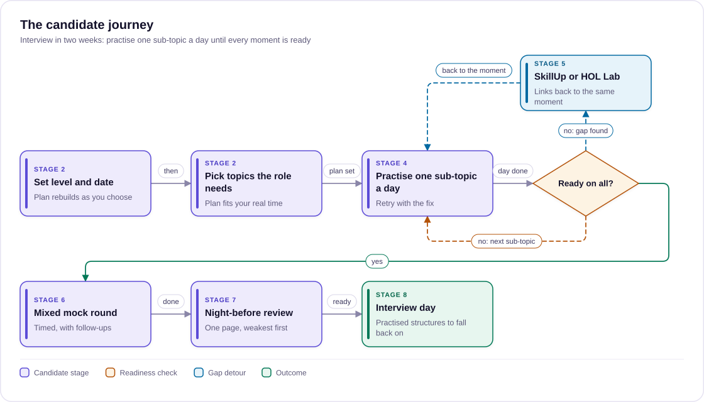

# Use cases

> Who uses Role Prep, for which jobs, and the journey a candidate takes: the 12 use cases and the nine-stage journey that later docs build on.
>
> Status: Draft · Updated: 2026-11-03 · Owner: Ajeet Chouksey
> Reads after: [01 Business case](01-business-case.md) · Next: [03 Epic, features and stories](03-epic-features-stories.md)

## At a glance

Role Prep serves 12 use cases. All of them use the same practice loop: answer out loud at your interview level, get scored, retry with one fix. What changes is who is practising, why, and where.

| # | Use case | Who | Trigger | Outcome | Where | Tier |
| --- | --- | --- | --- | --- | --- | --- |
| 1 | Interview in two weeks | Any candidate with a date | Interview booked | Every moment marked ready for their level by the day | Web, own AI | Free, then Pass |
| 2 | Switching into AI | Engineers moving into AI roles | Starting a job search | A topic-by-topic base before any interview is booked | Web | Free |
| 3 | Stepping up a level | Senior engineers going for lead or architect | Promotion or a lead-level opening | Answers that show judgement, not just knowledge | Web | Free, then Pass |
| 4 | Leadership panel | Directors and heads of AI or engineering | Executive or board-level interview | AI explained as impact, risk and cost, without jargon | Web | Pass |
| 5 | Night-before review | Any candidate | Interview tomorrow | One sheet of talking points, weakest first | Web | Free |
| 6 | Close a weak area | Any candidate | Low readiness on a topic | Gap learned in SkillUp or a HOL lab, then re-practised | Web | Free |
| 7 | Mock interview in your own AI | People who use Claude, ChatGPT, Copilot or Cursor | Prefers their own AI tool | Full mock interview scored on our rubrics | Own AI (MCP) | Free |
| 8 | Voice practice on the move | Busy candidates | Commute, walk, gym | Spoken practice in the AI app's voice mode | Own AI (MCP) | Free |
| 9 | Any chatbot, no MCP | People whose AI has no MCP support | Wants to practise in that chatbot | Question and rubric pasted into any AI | Copy as prompt | Free |
| 10 | Cohort preparation | Bootcamps and universities | A cohort nearing job interviews | Assigned topics and cohort readiness | Web | Teams (later) |
| 11 | Internal AI upskilling | Companies moving staff into AI roles | Internal mobility or promotion panels | Staff ready for internal AI-role interviews | Web | Teams (later) |
| 12 | Interviewer calibration | Hiring managers and interview panels | Setting up AI-role interviews | One shared bar per level, from our rubrics | Web | Teams (later), to explore |

Use cases 1 to 9 are in scope for phase 1 and 2 of the business case. Use cases 10 to 12 depend on a Teams tier and are listed so the content model supports them later.

## Main journey: interview in two weeks

The main use case is a candidate with a booked interview who practises one sub-topic a day until every moment is ready at their level.

*Six steps to interview day, looping until ready on all.*

The live prototype of this journey is [Role Prep practice prototype](https://claude.ai/artifact/2M4U1TkwGxn3Ddpuo95rGq): you can click through setup, today’s plan, practice with feedback, the mock interview and results.

The loop back from "Ready on all?" is where most of the time goes. Each day is one sub-topic, and a gap that practice alone won't fix detours through SkillUp or HOL Labs before coming back.

## Journey map

The journey has nine stages, and two are make-or-break: setup, where a plan has to feel achievable, and the first practice, where feedback has to feel worth a second try.

| Stage | What the candidate does | Thinks and feels | Touchpoints | Pain point | How Role Prep helps | Signal we measure |
| --- | --- | --- | --- | --- | --- | --- |
| 1. Discover | Searches "RAG interview questions" or follows a SkillUp link | "I have an interview and no idea what they'll ask" | Search, SkillUp pages, blog, word of mouth | Question lists are generic and read-only | Topic pages that answer at three levels | Landing to setup start |
| 2. Set up | Picks level, date, topics and minutes a day | Anxious about time; wants a plan | Setup screen with a live plan | Plans that don't fit their real time | Plan rebuilds as they choose; "doesn't fit" offers fixes that work | Setup completed, plan fits |
| 3. First practice | Answers the first moment out loud | Nervous; "is my answer any good?" | Practice room, speak button, timer | Speaking feels awkward the first time | Typing allowed; feedback quotes what they said and names one fix | Feedback requested on first moment |
| 4. Daily practice | One sub-topic a day, retrying with the fix | Motivated when scores rise, flat when they don't | Today card, practice room, own AI via MCP | Missing days; plan drifts | Pace line and spare days; practise anywhere through their own AI | Reps per week, 7-day return |
| 5. Gap detour | Follows a "close the gap" link | "I actually need to learn this" | SkillUp domain, HOL lab | Losing the thread after leaving | Links come back to the same moment | Return to Role Prep after a detour |
| 6. Mock round | Mixed, timed moments with follow-ups | Closest to the real thing; adrenaline | Mock round | Follow-ups expose shallow answers | Follow-ups from the rubric, at their level | Mock completed |
| 7. Night before | Reads the sheet, weakest first | Wants calm, not new material | Night-before sheet | Cramming new topics late | One page of structures and "say this" lines | Sheet opened the day before |
| 8. Interview day | Interviews | Confident on practised topics | None (no live help, by design) | Nerves | Practised structures to fall back on | None: we don't track the interview |
| 9. After the interview | Reports how it went, prepares for the next round | Relief, or a clear list of what tripped them | Short follow-up prompt, next-round setup | Starting over for round two | Keep readiness; reset date; add the topics that came up | Next-round setup, pass purchase |

The stages map onto the use cases above: stages 2 to 7 are use case 1, stage 5 is use case 6, stage 7 is use case 5, and stage 4 includes use cases 7 to 9 when practice happens in the candidate's own AI.

## Individual candidates

Six use cases cover the individual candidate. They differ by urgency (a date or no date) and by interview level.

### 1. Interview in two weeks

A candidate has an AI-role interview booked and limited evenings to prepare.

- **What they do:** set interview level and date, pick the topics the role needs, practise one sub-topic a day, then run a mixed mock round and the night-before review. The full flow is drawn under Main journey.
- **Features:** readiness meter, pace to interview date, speak your answer, AI feedback, night-before sheet.
- **Success looks like:** every moment for their level marked ready before the date, and a better score on the second attempt than the first.

### 2. Switching into AI

A software engineer wants to move into an AI or GenAI engineer role but has no interview booked yet.

- **What they do:** work through topics in order at Tech level, starting with "Know this cold" primers. They use typed practice until they are confident enough to speak.
- **Features:** topic and sub-topic structure, primers, structure-to-follow per question, links to SkillUp and HOL Labs for gaps.
- **Success looks like:** readiness above half on the core topics (RAG, agents, evaluation) before they start applying.

### 3. Stepping up a level

A senior engineer is going for a tech lead or architect role, and knows the technology but not how lead-level answers differ.

- **What they do:** answer at Tech level, then switch to Tech Lead and answer the same moment again, comparing the two strong answers and rubrics.
- **Features:** level switch, level-fit check ("too technical for this level"), Tech Lead rubrics that score evidence, success criteria and team decisions.
- **Success looks like:** level fit reported as "Right level" on Tech Lead answers.

### 4. Leadership panel

A director or head of engineering is preparing for an executive panel where AI strategy will come up.

- **What they do:** practise at Leadership level only, with a focus on pushback moments and challenges. They use the improved answer to tighten their own wording.
- **Features:** Leadership answer views (impact, risk, cost, reporting), pushback moments such as vendor claims, red flags such as "technical terms you don't translate".
- **Success looks like:** no jargon flagged, and every answer names a measurable target and a reporting rhythm.

### 5. Night-before review

The interview is tomorrow, and the candidate needs to review, not learn.

- **What they do:** open the night-before sheet for their level, read the weakest moments first, and say each structure out loud once.
- **Features:** night-before sheet, "say this" lines, expected follow-ups.
- **Success looks like:** a 15-minute review instead of a late-night cram.

### 6. Close a weak area

Readiness shows a gap, for example evaluation metrics, that practice alone will not fix.

- **What they do:** follow the "close the gap" link to the matching SkillUp domain or HOL lab, learn it, then return and re-practise the same moment.
- **Features:** gap links, readiness per sub-topic, attempt history showing the score change.
- **Success looks like:** the weak moment moves from "Not yet" to "Ready" after the learning detour.

## Practising in your own AI

Three use cases bring Role Prep into the AI tool the user already pays for. Our content and rubrics drive the practice, and their AI does the talking and scoring.

### 7. Mock interview in your own AI

A candidate lives in Claude, ChatGPT, Copilot or Cursor and would rather practise there than open another site.

1. Add the Role Prep MCP server URL to their AI tool once.
2. Run the `mock_interview` prompt with a sub-topic and level, for example "RAG, hybrid search, Tech Lead".
3. Their AI asks one question at a time, waits for the answer, then fetches our rubric with `get_rubric` and scores it.
4. They get the same feedback shape as on aaryaai.dev: points covered, one fix, the follow-up question.

**What it needs from us:** read-only MCP tools (`list_topics`, `list_subtopics`, `start_practice`, `get_rubric`) and the `mock_interview` prompt. Progress sync back to aaryaai.dev comes later, with login.

### 8. Voice practice on the move

A candidate has 30 minutes on a commute or a walk and no laptop.

- **What they do:** open their AI app's voice mode with the Role Prep server connected and say "run a 20-minute Tech interview on agents".
- **Why it matters:** this is the closest thing to a real phone screen, and it costs us nothing beyond serving content.
- **Limit:** voice-mode support for connectors varies by app and plan. Our setup page lists what works where.

### 9. Any chatbot, no MCP

A candidate uses an AI tool that cannot connect to MCP servers.

- **What they do:** press "Copy as prompt" on any question. This copies the question, the rubric for their level and the scoring instructions. They paste it into the chatbot, answer, and get scored.
- **Trade-off:** one question at a time, and no progress tracking. It still works with any AI.

## Organisations

Three use cases sell to organisations rather than individuals. All three need a Teams tier (seats, cohorts, an admin view), so they come after the individual product proves itself.

| # | Use case | Buyer | What they get | What we would need to build |
| --- | --- | --- | --- | --- |
| 10 | Cohort preparation | Bootcamp or university career lead | Assign sub-topics and levels to a cohort, see who is ready and which topics the cohort is weakest on | Seats, cohort groups, an instructor dashboard |
| 11 | Internal AI upskilling | Engineering or L&D leader moving staff into AI roles | Staff practise for internal AI-role interviews and promotion panels at the right level | Seats, company login, custom topics for their own stack |
| 12 | Interviewer calibration | Hiring manager or interview panel | Shared questions, rubrics and level-specific strong answers to set one bar per level | A read-only "interviewer view" of rubrics; terms that allow use in hiring |

**Note on use case 12:** it uses the same content from the other side of the table, so it needs care. Interviewer use must not leak rubrics in a way that lets candidates game real interviews. Treat it as exploratory until a hiring team asks for it.

## Links to the rest of aaryaai.dev

Role Prep shows what a candidate can't answer yet. The other verticals teach it, and the candidate comes back to practise. Each Role Prep topic maps to platform taxonomy IDs, so these links come from the shared relationships data rather than hand-written lists.

| When Role Prep shows | It links to | So the candidate can | Then back in Role Prep |
| --- | --- | --- | --- |
| A gap in concepts, e.g. evaluation metrics | SkillUp exam domain or skill track | Learn the concept with notes and MCQs | Re-practise the same moment |
| A gap in hands-on depth, e.g. never built hybrid search | HOL Lab | Build it once, so answers come from experience | Use the lab in a STAR answer |
| A need for a real example | Use Cases | Borrow a concrete business scenario | Ground Leadership answers in outcomes |
| A topic worth reading about | Blog | Read the platform's view, e.g. the Context Budget Rule | Use the same named terms in answers |

Traffic also runs the other way. A SkillUp learner who passes an exam domain is pointed to Role Prep to practise explaining it out loud, which turns exam prep into interview prep.

## Out of scope

Role Prep is for rehearsing before the interview, not for anything during or around it. These are deliberate exclusions:

- **Help during a live interview.** No real-time answer prompting or "interview copilot". It is dishonest to employers, and it is the opposite of building real skill.
- **Job-ad and company-specific packs.** We moved away from job-ad packs to evergreen topics. The three existing packs stay only as worked examples.
- **Coding and algorithm interviews.** Others cover these well. Role Prep covers AI concepts, AI system design, judgement and leadership.
- **CV writing, job search and salary negotiation.** These are adjacent career services, not interview practice.
- **Storing voice recordings.** Audio is transcribed and discarded. Only the text the candidate chooses to submit is kept.
- **Certifying readiness.** Readiness is self-assessed practice progress, not proof of skill, and we never present it as a credential.

Source: [Role Prep use cases](https://claude.ai/artifact/Me23noijYMtgNjeCX7ZzCu) (Claude Docs, imported 2026-11-03).
