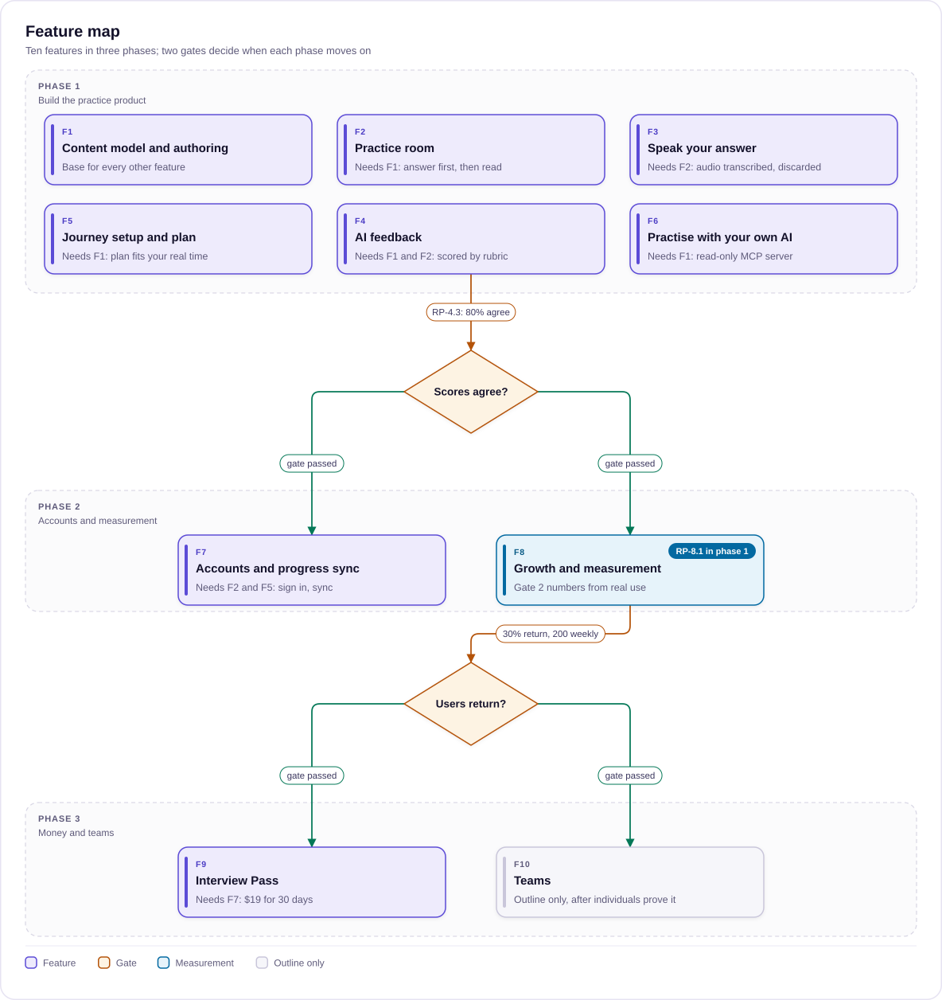

# Epic, features and stories

> The epic, ten features and their stories for Role Prep, with acceptance criteria, sizes, priorities, phases and gates. For the product owner and the developer building with the agent team.
>
> Status: Draft · Updated: 2026-11-03 · Owner: Ajeet Chouksey
> Reads after: [02 Use cases](02-use-cases.md) · Next: [04 UX and UI plan](04-ux-ui-plan.md)

## Epic: Role Prep practice

**Epic statement:** As someone interviewing for an AI role at Tech, Tech Lead or Leadership level, I want to rehearse interview answers out loud and get scored against the bar for my level, so that I walk into the interview having already answered the hard questions and their follow-ups.

**Goal:** replace today's read-only Role Prep (3 job-ad packs, 11 questions) with a practice product. A candidate answers out loud, gets scored against a rubric for their level, takes one fix and retries. They can do this in the Role Prep app or in their own AI tool.

**Where it is built (decided 2026-11-04):** the app is its own installable web app at roleprep.aaryaai.dev, built in `ajch_role_prep/app/` with its own Worker, not inside `ajch_platform`. Stories below that name `/roleprep/...` Worker routes, `aarya-subscribe` or `aarya-mcp` now map to that Worker's `/api/*` and `/mcp`. See [06 App architecture](06-app-architecture.md).

**Success metrics (from the business case, first proposals):**

| Metric | Target | Gate |
| --- | --- | --- |
| AI vs human scoring agreement | 80% of rubric points scored the same on 20 blind answers | Gate 1, before launch |
| Practisers returning within 7 days | 30% | Gate 2, before payments |
| Reps per active practiser per week | 10 or more | Tracked |
| Weekly active practisers | 200 before building payments | Gate 2 |
| Free to pass conversion | 3% of monthly active practisers | Phase 3 |

**In scope:**

- New content model
- Practice room
- Speak your answer
- AI feedback
- Journey setup and plan
- Read-only MCP server and copy as prompt
- Accounts and progress sync
- Growth and measurement
- Interview Pass

**Out of scope:** help during a live interview, job-ad packs, coding and algorithm interviews, CV and job-search tools, storing voice recordings, readiness as a credential. Teams is outlined only.

**Definition of done for every story:**

- Acceptance criteria met
- AppSec Engineer pre-build and post-build gates PASS
- `tsc`, `eslint --max-warnings=0` and content validation clean
- Works at 400px width and in light and dark themes
- Keyboard reachable
- No new raw Tailwind variant strings outside `src/components/ui`

**Sizes:** S is up to 2 days, M is 3 to 5 days, L is 1 to 2 weeks, for one developer working with the agent team. Priority uses Must, Should and Could within each feature.

## Feature map

Ten features in three phases, with 45 stories in F1 to F9. Two gates decide when each phase moves on.

*Ten features, three phases, two gates deciding progression.*

F1 unblocks everything. F2 and F4 complete the critical path to gate 1. Each card names the features it needs; later phases follow the gates.

## F1 Content model and authoring

Every question must carry a separate bar for Tech, Tech Lead and Leadership, and the agents must be able to write and refresh that content. Phase 1. No dependencies; every other feature depends on this one.

| ID | Story | Acceptance criteria | Size | Priority | Status |
| --- | --- | --- | --- | --- | --- |
| RP-1.1 | As a content author, I want a `roleprep@2` schema (topic, sub-topic, moments, each with three level views), so that every question has a bar per level | Kinds: know-this-cold, question, pushback, challenge, each with required fields; JSON Schema and a doc page in `docs/content-architecture.md`; a moment missing any level view fails validation | M | Must | To do |
| RP-1.2 | As a maintainer, I want the content validator to cover Role Prep, so that broken content never ships | `validate-content` checks `content/roleprep/**`: unique IDs, 3 to 6 rubric points per view, at least 1 follow-up on questions and challenges; runs in pre-commit and CI | S | Must | To do |
| RP-1.3 | As a content author, I want `roleprep-legacy-engineer` (formerly `interview-prep-engineer`) rewritten to author sub-topics instead of parsing job ads, so that content scales | Writes one sub-topic at a time at all three levels; follows no-strawman and level-fit rules; model tier set in `docs/agent-framework.md`; synced to the Role Prep repo | M | Must | To do |
| RP-1.4 | As a candidate, I want RAG & retrieval and Agents & orchestration written in depth, so that phase 1 has real practice | 9 sub-topics, 5 moments each, 3 levels; a human reviews 2 sub-topics blind; validator passes | L | Must | To do |
| RP-1.5 | As a maintainer, I want the 11 existing questions migrated and the job-ad packs archived, so that nothing useful is lost | Zero broken-encoding sequences; questions mapped to topics as Tech-level question moments; packs moved to `examples/` and hidden from the catalogue | S | Should | To do |
| RP-1.6 | As a maintainer, I want Role Prep content in its own repo, `ajch_role_prep`, so that it follows the vertical model | Repo created; `vertical-registry.json` entry with pipeline shape; `sync-vertical-agents.mjs` entry; `promote-content.yml` accepts `roleprep`; manifest serves a pinned commit | M | Must | To do |

## F2 Practice room

Practice comes before reading. The candidate answers first, then sees what good looks like at their level. Phase 1. Depends on F1. The prototype already shows the flow.

| ID | Story | Acceptance criteria | Size | Priority | Status |
| --- | --- | --- | --- | --- | --- |
| RP-2.1 | As a candidate, I want to work through a sub-topic as an ordered series of interview moments, so that practice feels like an interview | Rail shows each moment's kind and status; one moment at a time; next and previous; usable at 400px | M | Must | To do |
| RP-2.2 | As a candidate, I want to switch interview level and see the question asked the way that level asks it, so that I practise for my real interview | Level switch changes the prompt, strong answer, rubric and follow-ups; progress kept separately per level; readiness shown per level | S | Must | To do |
| RP-2.3 | As a candidate, I want to answer before I can see the strong answer, so that I practise recall rather than reading | Strong answer hidden until I submit or skip; timer with a target per kind (1, 2 or 5 minutes); timer shows a warning past target | S | Must | To do |
| RP-2.4 | As a candidate, I want to see what is being tested, the structure, a strong and a weak answer, follow-ups, red flags and phrases to use or avoid, so that I know what good looks like | All sections render for questions; challenges show scenario, rubric, model answer and follow-up; pushbacks show a verdict and reason for each option | M | Must | To do |
| RP-2.5 | As a candidate, I want to score myself against the rubric and rate my confidence, so that I can track readiness without AI | Checklist per rubric point; Not yet, Shaky or Ready; readiness percentage updates immediately | S | Must | To do |
| RP-2.6 | As a candidate, I want a night-before sheet for my level, weakest moments first, so that I can review in 15 minutes | One line per moment; ordered by confidence; each line links back to its moment | S | Should | To do |

## F3 Speak your answer

Candidates rehearse out loud, because that is how interviews are answered. Audio is transcribed and discarded. Phase 1. Depends on F2. It runs on the Workers AI binding of the Role Prep Worker (see [06 App architecture](06-app-architecture.md#api)).

| ID | Story | Acceptance criteria | Size | Priority | Status |
| --- | --- | --- | --- | --- | --- |
| RP-3.1 | As a candidate, I want to press "Speak your answer" and record, so that I practise out loud | Microphone permission asked only on the click; `MediaRecorder`; 3-minute limit; visible recording state and Stop; works in current Chrome, Edge, Safari and Firefox | M | Must | To do |
| RP-3.2 | As a candidate, I want my recording turned into editable text, so that I can fix misheard technical terms | `POST /api/transcribe` runs `@cf/openai/whisper-large-v3-turbo`; transcript within 10 seconds for a 2-minute answer (target); text editable; audio never stored or logged | M | Must | To do |
| RP-3.3 | As a candidate, I want length, pace, filler words and a length verdict, so that I improve how I say it, not only what I say | Computed in the browser; updates while typing and after speaking; filler list kept in one constant | S | Must | To do |
| RP-3.4 | As the platform owner, I want transcription rate-limited, so that the shared free AI allowance is protected | Reuses the Mentor's burst, daily and global limit pattern; friendly message on 429; upload size capped at about 3 minutes of audio | S | Must | To do |
| RP-3.5 | As a candidate, I want a clear privacy notice before my first recording, so that I trust the feature | One-time notice that audio is not stored; typed practice always available; `Permissions-Policy: microphone=(self), camera=()` added to `public/_headers` | S | Must | To do |

## F4 AI feedback

Feedback is the product's main promise: point-by-point, quoting the candidate's own words, with one fix and their own answer improved. Phase 1. Depends on F1 and F2. Gate 1 (scoring agreement) is decided here.

| ID | Story | Acceptance criteria | Size | Priority | Status |
| --- | --- | --- | --- | --- | --- |
| RP-4.1 | As a candidate, I want my answer scored point by point against the rubric for my level, so that I know exactly what I missed | `POST /api/feedback` takes item ID, level and answer; the Worker loads the rubric and reference from content, never from the browser; returns status and quoted evidence per point, level fit, strengths, red flags hit, one fix; response validated against a schema | L | Must | To do |
| RP-4.2 | As a candidate, I want my own answer rewritten to close the gaps, so that I have something I can actually say | Keeps the candidate's examples and order where possible; spoken style; 170 words or fewer; shown next to "fix this first" | S | Must | To do |
| RP-4.3 | As the product owner, I want the scoring model chosen by a blind pilot, so that feedback is trustworthy | 20 real answers scored by a human and by 2 candidate models; at least 80% agreement on rubric points to pass gate 1; result recorded in `docs/agent-framework.md`; model set per task through a Worker variable | M | Must | To do |
| RP-4.4 | As a candidate, I want to retry with the one fix pinned and see my score change, so that improvement is visible | "Try again with this fix" keeps the fix on screen; attempt history per moment and level; shows "up from X on your last try" | S | Must | To do |
| RP-4.5 | As a candidate, I want feedback to fail gracefully, so that I can still practise | On error or quota, falls back to self-scoring with a clear message; no automatic retries; 3 free feedbacks a day per user enforced on the server | S | Must | To do |
| RP-4.6 | As the platform owner, I want scoring that resists prompt injection, so that an answer can't talk its way to a higher score | Answer passed as delimited data; output schema enforced; input run through the same moderation model as the Mentor; AppSec Engineer review PASS | S | Must | To do |

## F5 Journey setup and plan

Setup is one of the two make-or-break stages in the journey map: the plan has to fit the candidate's real time and visibly react to every choice. Phase 1. Depends on F1 for the topic catalogue. The prototype's plan builder is the reference.

| ID | Story | Acceptance criteria | Size | Priority | Status |
| --- | --- | --- | --- | --- | --- |
| RP-5.1 | As a new candidate, I want to set my level, interview date, topics and minutes a day, so that I get a plan for my real situation | Four steps with defaults filled; suggested topics per level; "in 1, 2 or 4 weeks" shortcuts; core or full sub-topic depth | M | Must | To do |
| RP-5.2 | As a candidate, I want the plan to rebuild as I choose, so that I can see whether it fits before I start | Forecast sentence, day strip and day list update on every change; mock round the day before last, review the day before; spare days shown | M | Must | To do |
| RP-5.3 | As a candidate, I want one-click fixes when my plan doesn't fit, so that I don't have to guess what to cut | Lists the sub-topics not covered; every fix offered produces a plan that fits; interview tomorrow shows a review-only message | S | Must | To do |
| RP-5.4 | As a candidate, I want a Today card in practice, so that I know what to do each day | Shows day N of M, what to practise and minutes; Edit plan; a missed day rolls work forward instead of skipping it | M | Should | To do |
| RP-5.5 | As a developer, I want the plan builder in `src/lib` with unit tests, so that changes can't silently break plans | Vitest covers fits, doesn't fit, close dates and depth; included in `test:coverage` scope | S | Must | To do |

## F6 Practise with your own AI

Role Prep becomes a tool inside the candidate's own AI: our rubrics, their AI and their subscription. Phase 1, read-only. Depends on F1. Lead with Claude, VS Code and Cursor; name ChatGPT only once consumer access is verified.

| ID | Story | Acceptance criteria | Size | Priority | Status |
| --- | --- | --- | --- | --- | --- |
| RP-6.1 | As a candidate using Claude, VS Code or Cursor, I want to connect a Role Prep MCP server, so that I can practise in my own AI | Served by the Role Prep Worker at `/mcp` on roleprep.aaryaai.dev (see [06 App architecture](06-app-architecture.md#api)), built with the Agents SDK over Streamable HTTP; read-only, no login; IP rate limits; content read from the same commit as the app | L | Must | To do |
| RP-6.2 | As a candidate's AI, I want tools to browse and fetch practice content, so that it can run practice on our bar | `list_topics`, `list_subtopics`, `start_practice` (prompts without answers) and `get_rubric` (rubric, reference and follow-ups for one item and level); input schemas documented | M | Must | To do |
| RP-6.3 | As a candidate, I want a ready-made mock interview, so that my AI runs a full session without me writing a prompt | `mock_interview` offered as both an MCP prompt and a tool, for clients that skip prompts; asks one question at a time, waits, scores with `get_rubric`, gives one fix, then the follow-up | S | Must | To do |
| RP-6.4 | As a candidate, I want a setup page, so that I can connect in about a minute | "Practise with your own AI" page with steps for Claude, VS Code and Cursor; server URL with a copy button; ChatGPT listed only after access is verified | S | Should | To do |
| RP-6.5 | As a candidate whose AI has no MCP support, I want to copy a question as a prompt, so that I can practise in any chatbot | Button on every moment copies the question, the rubric for my level and scoring instructions; falls back to selecting the text if the clipboard is blocked | S | Must | To do |

## F7 Accounts and progress sync

Progress follows the candidate across devices once they sign in, using the login that already exists. Phase 2. Depends on F2 and F5. Follows the enrollment and progress model in IDEA-0006.

| ID | Story | Acceptance criteria | Size | Priority | Status |
| --- | --- | --- | --- | --- | --- |
| RP-7.1 | As a candidate, I want my plan, attempts and readiness saved to my account, so that I can switch devices | D1 tables for Role Prep progress; GitHub or Google sign-in; progress kept in the browser merges on first sign-in without loss | M | Should | To do |
| RP-7.2 | As a candidate, I want my interview date kept as an enrollment, so that my plan and countdown survive a new device | Explicit enrollment with target date, as IDEA-0006 defines for goal-driven verticals; editing the plan updates the enrollment | S | Should | To do |
| RP-7.3 | As a candidate, I want to delete my practice data, so that I stay in control of it | One action deletes all Role Prep rows for the user; confirmation step in the page; covered by an API test | S | Must | To do |

## F8 Growth and measurement

Gate 2 can only be judged with real numbers, and the first 1,000 practisers come from channels we already own. Phase 2. Analytics (RP-8.1) ships with phase 1 so that data exists from day one.

| ID | Story | Acceptance criteria | Size | Priority | Status |
| --- | --- | --- | --- | --- | --- |
| RP-8.1 | As the product owner, I want practice events tracked, so that we can judge both gates | Events: setup completed, rep started, feedback requested, retry, marked ready, return within 7 days; sent through the existing GA4 proxy; no answer text or transcript ever sent | M | Must | To do |
| RP-8.2 | As someone searching for AI interview questions, I want a public page per sub-topic, so that I find Role Prep and see the three-level difference | One page per sub-topic showing one sample moment at all three levels; in the sitemap with Open Graph image; links into setup | M | Should | To do |
| RP-8.3 | As a SkillUp learner, I want to be pointed to Role Prep after passing a domain, and back to SkillUp from a Role Prep gap, so that learning and practice connect | "Practise explaining it" link after a passed domain; Role Prep gap links come from `relationships.json` through shared taxonomy IDs | S | Should | To do |
| RP-8.4 | As a candidate browsing MCP directories, I want to find Role Prep there, so that I can add it to my AI | Listing in public MCP directories once RP-6.1 is live, linking to the setup page | S | Could | To do |
| RP-8.5 | As the product owner, I want a gate dashboard, so that the go or no-go for payments is based on data | Scoring agreement, 7-day return and weekly active practisers on the monitoring page, refreshed weekly | S | Must | To do |

## F9 Interview Pass and payments

The pass is sold for the weeks before an interview, not as an open-ended subscription. Phase 3, built only after gate 2 is met. Depends on F7. Prices are $19 for 30 days and $39 for 90 days, to be tested.

| ID | Story | Acceptance criteria | Size | Priority | Status |
| --- | --- | --- | --- | --- | --- |
| RP-9.1 | As a candidate, I want to buy a 30-day or 90-day Interview Pass, so that I get unlimited practice before my interview | Payment provider chosen and integrated; checkout for both passes; receipt by email; pass start and end stored against the account | L | Must | To do |
| RP-9.2 | As the platform owner, I want pass checks on the server, so that paid features can't be unlocked in the browser | Transcribe and feedback routes check the entitlement; free cap of 3 feedbacks a day stays for others; fair-use cap for pass holders | M | Must | To do |
| RP-9.3 | As a pass holder practising in my own AI, I want that practice to count towards my readiness, so that both places stay in sync | MCP server adds OAuth with `workers-oauth-provider` on top of existing GitHub and Google login; a `record_attempt` tool writes only for signed-in pass holders | L | Should | To do |
| RP-9.4 | As a pass holder, I want a reminder before my pass ends and when my interview is close, so that I make use of what I paid for | Reminder 3 days before expiry and 2 days before the interview date; easy opt-out | S | Could | To do |

## F10 Teams (later, outline only)

Teams is the larger revenue lever in the business case, but it starts only after individuals prove the product. No stories are written yet; these are the capabilities to break down when the time comes.

- **Cohorts and seats:** an instructor buys seats, invites a cohort and assigns sub-topics and levels.
- **Instructor dashboard:** cohort readiness by topic, weakest moments across the group, who is behind their plan.
- **Company sign-in and custom topics:** for companies moving staff into AI roles, topics on their own stack.
- **Interviewer view (exploratory):** read-only rubrics for hiring panels, with terms that stop candidates gaming real interviews.
- **First step:** one free bootcamp pilot cohort in exchange for feedback, after gate 2.

## Dependencies, risks and open decisions

The critical path is F1, then F2 and F4, then gate 1. There is no launch until there is real content and scoring we trust.

**Dependencies outside this epic:**

- **Promotion pipeline:** the content promotion fix in PR #843 must be merged before Role Prep content can be promoted.
- **Accounts:** enrollment and progress tables from IDEA-0006 are needed for F7.
- **Model tiering:** the Role Prep authoring agent needs its model set, following `docs/agent-framework.md`.

**Top delivery risks** (full list in the business case):

- **Scoring too generous.** RP-4.3 is a gate, not a nice-to-have.
- **Content slower to write than planned.** RP-1.4 is the largest story; start it first, in parallel with F2.
- **ChatGPT reach narrower than assumed.** RP-6.4 leads with Claude, VS Code and Cursor.

**Open decisions:**

- [ ] Scoring model for `/api/feedback`: decided by RP-4.3
- [ ] Payment provider for the Interview Pass (RP-9.1)
- [ ] Final pass prices after the willingness-to-pay test
- [ ] Whether public sub-topic pages (RP-8.2) show one sample moment or a full sub-topic

Source: [Role Prep epic, features and stories](https://claude.ai/artifact/HyquNaYh7vFF2RPUGfEsYu) in Claude Docs. This repo copy is the source of truth from now on.
