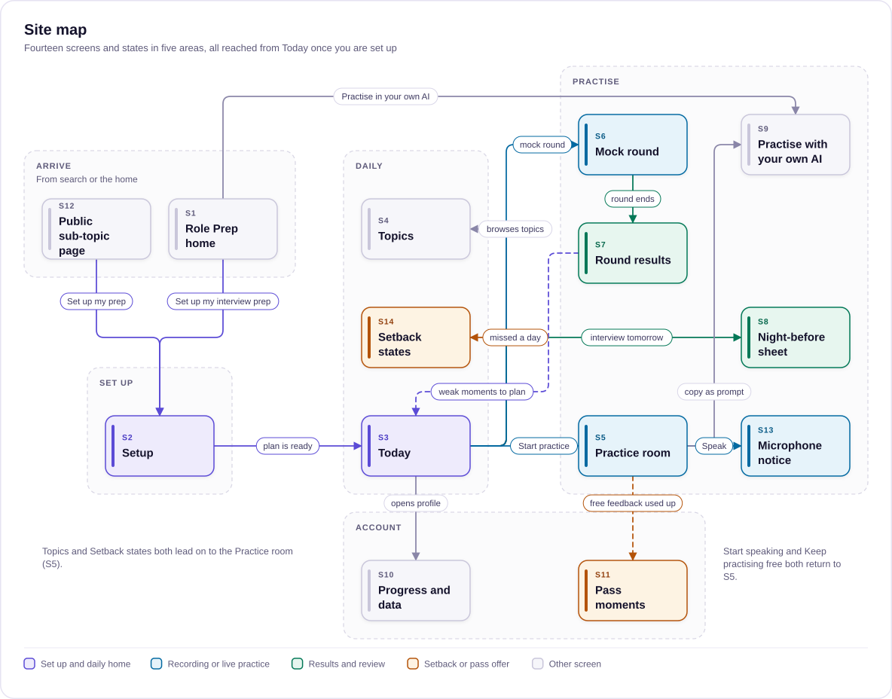
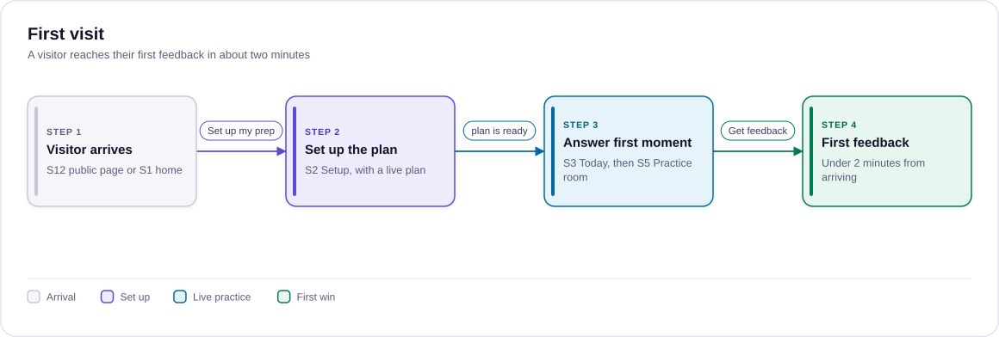
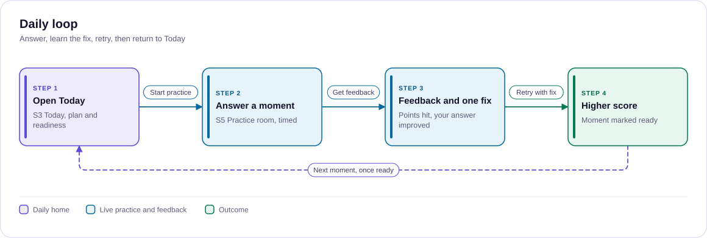
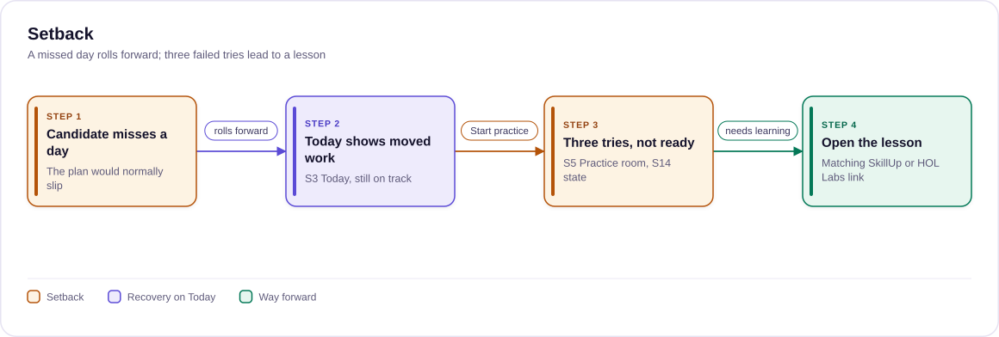
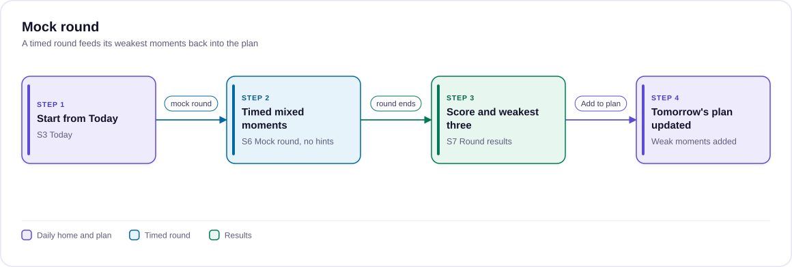
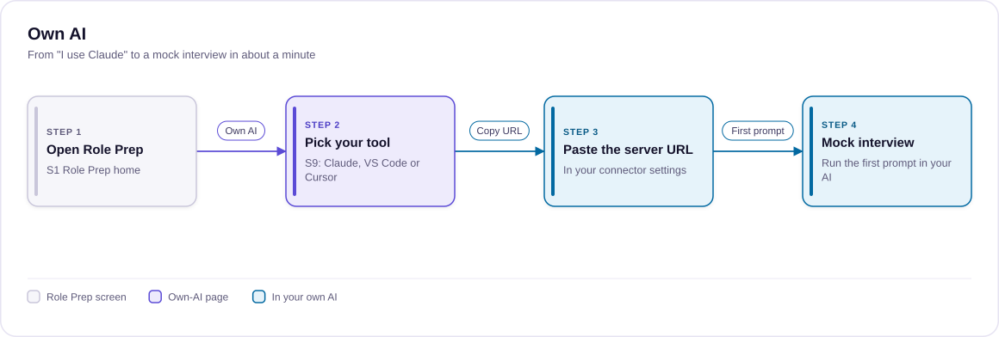

# UX and UI plan

> How every Role Prep feature looks and behaves: the screens, flows, states and visual rules the build follows, for designers and the developers who implement them.
>
> Status: Draft · Updated: 2026-11-03 · Owner: Ajeet Chouksey
> Reads after: [03 Epic, features and stories](03-epic-features-stories.md) · Next: [05 Repo, brand and agent kit plan](05-repo-brand-agent-kit-plan.md)

## Summary

Role Prep feels like a private interview studio. You tell it about your interview, and it gives you today's practice. You answer out loud, hear what was missing in your own words, and try again until the moment is ready. Everything else exists to bring people into that loop, bring them back each day, or let them run it in their own AI.

**The UX bar.** Every screen must pass the six principles of the existing learner-experience standard, with Role Prep's own test for each:

| # | Principle | Role Prep pass test |
| --- | --- | --- |
| 1 | Learner-driven | The candidate picks level, date, topics and minutes a day, and can change any of them later |
| 2 | Visibly reactive | Every choice or answer changes the screen at once: plan, score, readiness, next step |
| 3 | Felt progress | Readiness per sub-topic and level, the score change between attempts, days to go |
| 4 | Always a next step | Every screen ends in one specific action: "Answer moment 2", "Try again with this fix" |
| 5 | Real data | Built from real `roleprep@2` content and the candidate's real attempts; examples are labelled |
| 6 | Phone width | Works at 360px, with the primary action visible without scrolling sideways |

**Journey moments to design** (from the same standard, adapted): arrive, set up, first win in under 2 minutes, daily loop, setback (a missed day or a falling score), mock round, night before, interview day, after. A design that skips the setback moment is incomplete, because that is where people quit.

**Already prototyped:** setup with a live plan, the practice room for all four moment kinds, speak your answer, AI feedback with retry, the Today card and the night-before sheet. This plan covers those screens and the ones not yet designed.

Open the [Role Prep practice prototype](https://claude.ai/artifact/2M4U1TkwGxn3Ddpuo95rGq) to click through the multi-screen flow on one sub-topic, RAG → Hybrid search and reranking: setup with a live plan, the practice room, speaking an answer, AI feedback with retry, the Today card and the night-before sheet.

## Information architecture

Visitors arrive from search or the Role Prep home, set up once, and then live on Today. Practice, mock rounds and the night-before sheet all start from Today, and results feed back into the plan.


*Fourteen screens and states, grouped by area, joined by navigation.*

## Key flows

Five flows, four steps each. The first-visit flow is the one to get right first. A visitor should reach their first feedback within about 2 minutes, which is the "first win" the learner-experience standard asks for. The setback flow is the one most products skip: a missed day rolls work forward instead of breaking the plan, and three failed tries send the candidate to a lesson instead of a fourth try.

### First visit


*First feedback within about two minutes of arriving.*

### Daily loop


*Answer, learn the fix, retry, then return to Today.*

### Setback


*A missed day rolls forward; three failed tries lead to a lesson.*

### Mock round


*A timed round feeds its weakest moments back into the plan.*

### Own AI


*From "I use Claude" to a mock interview in about a minute.*

## Screen inventory

There are fourteen screens and states. Six are prototyped. The eight not yet designed include the mock round, which has no story in the epic yet.

| # | Screen | Route | Job | Stories | Prototype |
| --- | --- | --- | --- | --- | --- |
| S1 | Role Prep home | `/roleprep` | Show the three-level difference in 30 seconds; start setup | RP-8.2, RP-5.1 | Not designed |
| S2 | Setup | `/roleprep/setup` | Level, date, topics, minutes a day; live plan | RP-5.1 to 5.3 | Built |
| S3 | Today | `/roleprep/today` | Today's practice, plan strip, readiness, days to go | RP-5.4, RP-2.5 | Partly (Today card) |
| S4 | Topics | `/roleprep/topics` | All 12 topics with readiness; practise anything off-plan | RP-2.1 | Not designed |
| S5 | Practice room | `/roleprep/:topic/:subtopic` | Answer a moment, get feedback, retry | RP-2.1 to 2.5, RP-3.1 to 3.3, RP-4.1 to 4.5, RP-6.5 | Built |
| S6 | Mock round | `/roleprep/mock` | Timed mixed moments with follow-ups, no hints | Missing story | Not designed |
| S7 | Round results | `/roleprep/mock/results` | Score per moment, weakest three, next step | Missing story | Not designed |
| S8 | Night-before sheet | `/roleprep/review` | One page of structures and phrases, weakest first | RP-2.6 | Built (inline) |
| S9 | Practise with your own AI | `/roleprep/own-ai` | Connect Claude, VS Code or Cursor; copy as prompt | RP-6.4, RP-6.5 | Not designed |
| S10 | Progress and data | `/profile/roleprep` | Readiness history, sign-in to sync, delete data | RP-7.1 to 7.3 | Not designed |
| S11 | Pass moments | in context, plus `/roleprep/pass` | Offer the pass when the free feedback cap is hit; checkout; pass status | RP-9.1 to 9.4 | Not designed |
| S12 | Public sub-topic page | `/roleprep/learn/:topic/:subtopic` | Search landing: one moment at three levels, then setup | RP-8.2 | Not designed |
| S13 | Microphone notice | modal on first Speak | Explain that audio is not stored; offer typing | RP-3.5 | Not designed |
| S14 | Setback states | on S3 and S5 | Missed day, falling score, quota reached | RP-5.4, RP-4.5 | Not designed |

## Screen specs

Each spec gives the screen's one job, its layout, its states and the single next action it ends on. The wireframes are for layout only; visual style follows the [visual direction](#visual-direction) section.

### S1 Role Prep home

Show, in 30 seconds and without sign-up, that the same question has three different good answers.

```text
ROLE PREP
Practise the AI interview you'll actually face.

"When would you add a reranker?"        [Tech] [Tech Lead] [Leadership]
┌ Strong answer at Tech Lead ─────────────────────┐
│ Ask for the failure analysis first ...       │   <- changes as you tap a level
└─────────────────────────────────────────────┘

[ Set up my interview prep ]   Practise in your own AI →
12 topics · 3 levels · speak your answer · feedback on every try
```

- **States:** first visit (as above). A returning visitor with a plan goes straight to Today.
- **Next action:** Set up my interview prep.

### S3 Today

The daily home: what to practise now, how close you are and how many days are left.

```text
DAY 4 OF 14 · TECH LEAD INTERVIEW ON 17 NOV
RAG & retrieval · Grounding & citations            ~30 min
[ Start today's practice ]

Plan  ▁▂▂▃▃▂▁▁▂▃ ◆ ● |   (today outlined; mock, review, interview)
Ready 42%  ▲ 8 since yesterday
  RAG ██████░░  Agents ██░░░░  Evaluation ░░░░░░
Weakest moment: "How do you know reranking helped?"  [Retry]
```

- **States:** on plan; ahead of plan (offer the next sub-topic or a mock round); missed day (S14); interview tomorrow (review only); no plan (send to setup).
- **Next action:** Start today's practice.

### S5 Practice room

Answer one moment, then see what you missed, and try again with one fix.

```text
← RAG & retrieval · Hybrid search          Moment 2 of 5      [Tech | Lead | Leadership]

INTERVIEWER
"Your team wants to add a reranker. How do you decide it's worth it?"

0:42 / 2:00  ████░░░░        [● Speak your answer]   or type
┌ your transcript (editable) ───────────────────────────────────┐
└─────────────────────────────────────────────────────┘
184 words · 1:19 spoken · 3 fillers                [ Get feedback ]  Skip to strong answer

--- after feedback ---
3 of 4 points   up from 1.5 on your last try
✓ Asked for evidence first      "show me the failure analysis"
◑ Success criteria             named a metric, no latency budget
✗ Regression gate             not mentioned
Fix this first: make the eval set a CI gate.
Your answer, improved: ...                       [ Try again with this fix ]
```

- **Answer state:** prompt in the interviewer's voice, timer, speak or type, live delivery stats, one primary action.
- **Feedback state:** score and change, points with quotes, level fit, one fix, improved answer, then the strong answer and follow-ups lower down.
- **States:** loading ("Comparing your answer", 10 to 40 seconds), feedback unavailable (self-score fallback), quota reached (S11), microphone blocked (type instead).
- **Next action:** Get feedback, then Try again with this fix, then Next moment once marked ready.

### S6 Mock round and S7 results

Rehearse under interview conditions: mixed moments from your topics, timed, with no hints until the end.

- **Layout:** one moment at a time, interviewer voice, a round timer (for example 20 minutes for 4 moments), and a follow-up asked after each answer. No strong answers or rubrics are shown during the round.
- **Results:** score per moment, the three weakest with one fix each, readiness change, and "Add these to tomorrow's plan".
- **States:** in progress, paused (resume within 24 hours), abandoned (partial results kept).
- **Next action:** Add weak moments to my plan.

### S9 Practise with your own AI

Get someone from "I use Claude" to running a mock interview there in about a minute.

- **Layout:** pick your tool (Claude, VS Code, Cursor) as tabs; three numbered steps per tool; the server URL with a copy button; a "Try this first" prompt such as "Run a Tech Lead mock interview on RAG". Below that, a fallback: "No MCP? Copy any question as a prompt."
- **States:** copied ("Copied. Paste it into your connector settings"), clipboard blocked (text selected instead). ChatGPT is shown only once its access is verified.
- **Next action:** Copy server URL.

### S11 Pass moments

Offer the pass when it is useful, never as a wall in front of the content.

- **Where it appears:** at the 4th feedback of the day ("You've used today's 3 free feedbacks. Keep going with typed practice, or get unlimited feedback until your interview on 17 Nov"), and on Today once the plan has more practice than the free cap allows.
- **Checkout:** two cards, 30 days and 90 days, each showing the date it ends against the interview date. Pass status sits on Today and the profile.
- **States:** free, pass active (days left), pass ending (3 days before), expired.
- **Next action:** Get the pass, with "Keep practising free" always beside it.

### S13 Microphone notice

Shown once, on the first press of Speak: "Your answer is turned into text and the audio is thrown away. Nothing is recorded or stored." Buttons: "Start speaking" and "I'll type instead". If the browser blocks the microphone, the same space explains how to type instead.

### S14 Setback states

The moments where people quit get their own designs, each with a kind message and one action.

| Setback | What the candidate sees | Next action |
| --- | --- | --- |
| Missed a day | "Yesterday's practice moved to today. You're still on track for 17 Nov" or, if not, "Two sub-topics won't fit now" with the fixes from setup | Start today's practice |
| Score dropped on a retry | "Lower this time: you dropped the regression gate. Here is the one fix" | Try again with this fix |
| Stuck on a moment (3 tries, not ready) | "This one needs learning, not more practice", with the matching SkillUp or HOL Labs link | Open the lesson |
| Free feedback used up | S11 in-context offer, with typed self-scoring still available | Keep practising free |
| Interview tomorrow and not ready | "Focus on your 3 weakest moments tonight", then the night-before sheet | Open the night-before sheet |

## Visual direction

The look is AaryaAI brand v2 with a "practice studio" layer: calm and dark by default, with one live colour that only appears while you are answering.

| Element | Rule | Example |
| --- | --- | --- |
| Ground and cards | App ground #0e1a2d, glass cards from `src/components/ui`; light theme follows the brand tokens | Practice room card on the dark ground |
| Accent | Brand indigo #5B4BD6 for the one primary action per screen | "Get feedback", "Start today's practice" |
| Live accent | Sky, only for listening, a running timer and the follow-up probe | Pulsing dot while speaking |
| Status | Emerald covered, amber partly, rose missed; always with the word | "✓ Covered" chip |
| Levels | No colour; shown by name and place in the level switch | Tech, Tech Lead, Leadership |
| Interviewer voice | Barlow Condensed 600, 24 to 30px, for what the interviewer says | The question bubble |
| Coaching voice | Barlow 400 at 16 to 17px, line height 1.55 | Strong answer, fixes |
| Numbers | Tabular figures for timer, scores, word counts | "3 of 4 points", "1:19" |
| Labels | Barlow Condensed uppercase with wide tracking (brand v2 §6) | "WHAT THEY'RE REALLY TESTING" |
| Blueprint details | Hairline rules and registration marks, sparingly | Plan strip, night-before sheet |
| Motion | One moment per screen: timer fill, speaking pulse, score count-up; none with reduced motion | Score rises from 1.5 to 3 |

**Microcopy rules:**

- **Talk like a coach.** "You dropped the regression gate", not "Rubric item 4 not satisfied".
- **Make buttons say what happens.** "Try again with this fix", not "Retry".
- **Make errors say what to do.** "Microphone blocked. Type your answer instead".
- **Never present readiness as a credential.** It is practice progress.
- **Label example content.** Show "Example" until it is the candidate's own data.

## Component inventory

Role Prep reuses the platform primitives and adds 13 components. The 5 general-purpose ones go into `src/components/ui` through the Design Systems Engineer; the rest stay in `src/features/roleprep`.

| Component | Used on | Kind | Owner |
| --- | --- | --- | --- |
| `GlassCard`, `Badge`, `Button`, `StatGrid`, `SectionHeader`, `Breadcrumb` | All | Reused primitive | Design Systems Engineer |
| `SegmentedControl` (level switch, minutes, depth) | S2, S5, S1 | New primitive | Design Systems Engineer |
| `ProgressMeter` (readiness bar with change since last time) | S3, S4, S10 | New primitive | Design Systems Engineer |
| `TimerBar` (count-up with target and over-target state) | S5, S6 | New primitive | Design Systems Engineer |
| `CheckRow` (status chip, point, quoted evidence) | S5, S7 | New primitive | Design Systems Engineer |
| `CopyField` (value plus copy button with fallback) | S9 | New primitive | Design Systems Engineer |
| `InterviewerBubble` | S5, S6, S1 | Role Prep | Platform Dev Expert |
| `SpeakButton` and `useSpeechAnswer` hook | S5, S6 | Role Prep | Platform Dev Expert |
| `DeliveryStats` | S5 | Role Prep | Platform Dev Expert |
| `FeedbackPanel` (score, points, level fit, fix, improved answer) | S5, S7 | Role Prep | Platform Dev Expert |
| `MomentRail` | S5 | Role Prep | Platform Dev Expert |
| `PlanStrip` and `PlanList` | S2, S3 | Role Prep | Platform Dev Expert |
| `TodayCard` | S3 | Role Prep | Platform Dev Expert |
| `PassOffer` | S11 | Role Prep | Platform Dev Expert |

Every component needs light and dark themes, keyboard focus states, a 360px layout and `data-testid` attributes, which the platform's end-to-end tests are currently blocked on.

## Responsive, accessibility and privacy

People practise on phones on the move, so every screen is designed at 360px first and then widened.

**Responsive:**

- **Phone:** the moment rail becomes a swipeable strip. The primary action sits in a sticky bar at the bottom, above the safe area. The plan strip scrolls sideways inside its own box, never the page.
- **Tablet and up:** the rail sits on the left, the practice card in the middle and, from 1100px, feedback alongside the answer.
- **Speaking on a phone:** large Speak and Stop targets (at least 44px), and the screen kept awake while recording where the browser allows.

**Accessibility:**

- **Keyboard:** every action is reachable by keyboard; Space starts and stops speaking when the Speak button has focus.
- **Screen readers:** feedback is announced in order (score, then each point), and live regions announce "Recording" and "Feedback ready".
- **Colour:** status is never colour alone; every chip carries its word, and all text meets 4.5:1 contrast in both themes.
- **Motion:** reduced motion turns off pulses, count-ups and the timer fill animation.
- **Typing first-class:** speaking is optional everywhere, for people who can't or prefer not to speak.

**Privacy in the experience:**

- **First recording:** the microphone notice (S13) explains that audio is discarded.
- **Answer text:** stays in the browser until the candidate asks for feedback, and is never sent to analytics.
- **Profile:** shows what is stored and offers one-step deletion (S10).
- **Own AI:** the page says plainly that practice in the candidate's own AI follows that tool's privacy terms.

## Coverage check

Every epic feature with a user-facing story has a home screen. The check found three gaps in the epic, listed under the table. They should be added before build.

| Feature | Stories | Screens | Notes |
| --- | --- | --- | --- |
| F1 Content model | RP-1.1 to 1.6 | None directly | Content drives every screen; no UI of its own |
| F2 Practice room | RP-2.1 to 2.6 | S5, S8 | Covered |
| F3 Speak your answer | RP-3.1 to 3.5 | S5, S13 | Covered |
| F4 AI feedback | RP-4.1 to 4.6 | S5, S11, S14 | Covered |
| F5 Setup and plan | RP-5.1 to 5.5 | S2, S3, S14 | Covered |
| F6 Own AI | RP-6.1 to 6.5 | S9, S5 (copy as prompt) | The MCP server itself has no UI |
| F7 Accounts and sync | RP-7.1 to 7.3 | S10 | Covered |
| F8 Growth and data | RP-8.1 to 8.5 | S1, S12; monitoring page for RP-8.5 | Analytics events are invisible by design |
| F9 Interview Pass | RP-9.1 to 9.4 | S11, S3 | Covered |

**Gaps to add to the epic:**

- [ ] **RP-2.7 Mock round:** as a candidate, I want a timed round of mixed moments with follow-ups and no hints, so that I rehearse real interview conditions (S6).
- [ ] **RP-2.8 Round results:** as a candidate, I want my weakest moments from a round added to my plan, so that the round changes what I practise next (S7).
- [ ] **RP-5.6 Stuck moment:** as a candidate, I want to be sent to the matching lesson after 3 tries without getting ready, so that I stop repeating what I don't yet know (S14).

## Next: prototype and test

Prototype the four screens that decide whether people come back, test with five candidates, then build. That follows the owner's rule: UX is approved before it is built.

**Prototype next, in this order:**

1. **S3 Today with S14 setbacks:** the daily home and the missed-day, falling-score and stuck states.
2. **S6 Mock round and S7 results:** the biggest experience not yet designed.
3. **S1 Role Prep home:** the three-level switch that sells the product in 30 seconds.
4. **S9 Practise with your own AI:** check that "connect in a minute" is true.

**Usability test (5 candidates: 2 Tech, 2 Tech Lead, 1 Leadership):**

| Task | Pass when |
| --- | --- |
| Set up prep for an interview in 10 days | Plan fits without help, in under 2 minutes |
| Answer the first moment out loud and get feedback | First feedback in under 2 minutes from arriving (the "first win") |
| Improve a score using the fix | Second attempt scores higher, and they can say why |
| Recover from a missed day | They find what to do without asking |
| Connect Role Prep to Claude | Running a mock interview in their AI within 5 minutes |

Also ask: did the feedback feel fair, and would they come back tomorrow? Those answers feed gate 2.

Source: [Role Prep UX and UI plan](https://claude.ai/artifact/LTJCHFoiodyDEHvRPqnr7T), imported 2026-11-03. This repo copy is the source of truth from here on.
