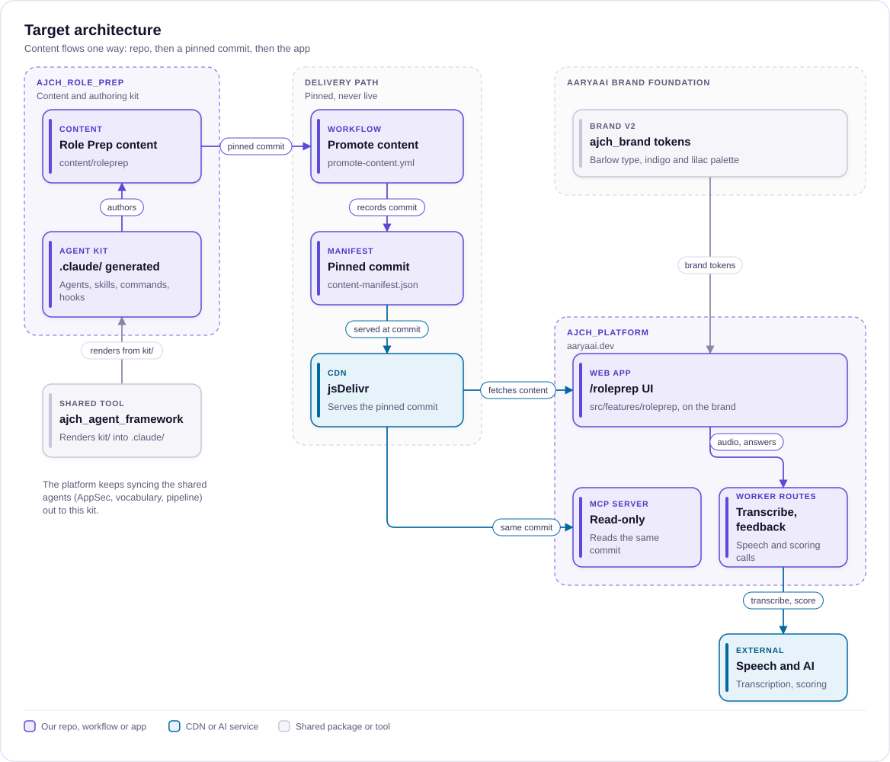
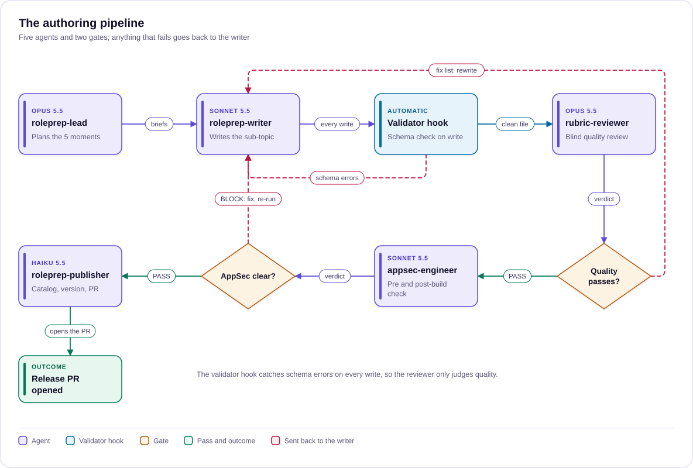

# Repo, brand and agent kit plan

> Where Role Prep's content, code, brand and agents live, and how the authoring pipeline and migration run; for whoever builds or maintains the repo.
>
> Status: Draft · Updated: 2026-11-03 · Owner: Ajeet Chouksey
> Reads after: [04 UX and UI plan](04-ux-ui-plan.md) · Next: [06 App architecture](06-app-architecture.md)

## Summary

Role Prep content moves out of `ajch_platform` into a new repo, `ajch_role_prep`. The repo also carries its own Anthropic-style agent kit (agents, skills, slash commands, scripts and hooks), packaged later as a Claude Code plugin. The Role Prep UI was planned to stay in the aaryaai.dev app; since 2026-11-04 it is its own app in `ajch_role_prep/app/` (see [06 App architecture](06-app-architecture.md)), built on the AaryaAI brand with a small Role Prep extension of its own.

**What moves where:**

| Today | After |
| --- | --- |
| `ajch_platform/public/content/interviews/` (3 job-ad packs, 11 questions) | `ajch_role_prep/content/roleprep/` in the `roleprep@2` structure; packs kept as examples |
| `roleprep-legacy-engineer` agent in `ajch_platform`, formerly `interview-prep-engineer` (turns job ads into packs) | Role Prep agent kit in `ajch_role_prep`: lead, writer, reviewer, publisher, plus skills and commands |
| Platform serves the content from its own folder | Platform loads the content from a pinned commit through `content-manifest.json`, like SkillUp |
| UI in `src/features/interview` | UI in `src/features/roleprep`, same `/roleprep` route, restyled on the brand foundation |

**Finding that changes step one:** the shared `@aaryaai/brand` package (`ajch_brand`) is out of date. It still specifies Inter with violet and sky. Brand v2 (`ajch_food_for_thoughts/brand/BRAND.md`) and the live platform both use Barlow and Barlow Condensed with indigo #5B4BD6 and lilac #A99BFF. Bringing the package up to v2 comes before Role Prep builds on it.

**Decisions this plan needs:**

1. Which repo owns the Role Prep-only agents and skills (see open decisions; recommended: `ajch_role_prep`).
2. Role Prep's accent pair within the brand (proposed in Brand foundation).
3. Whether to publish the agent kit as an installable plugin (recommended: yes, as the final phase).

## Target architecture

The new repo owns content and the authoring kit. As planned, aaryaai.dev and the MCP server only ever read a promoted, pinned commit; since 2026-11-04 the app ships from the same commit as the content, so Role Prep needs no promotion step (see [06 App architecture](06-app-architecture.md)). Brand tokens arrive as a git dependency, and the platform keeps syncing the shared agents out.


*Content, kit and app ship together from one commit.*

## Repo layout

`ajch_role_prep` follows the shape of `ajch_skillup`: content at the root, the agent kit in `.claude/`, scripts and CI beside them. It then adds an installable plugin folder in Anthropic's format.

```
ajch_role_prep/
├── README.md                    # stacked lockup at 180px, centred (brand v2 §7)
├── CLAUDE.md                    # how agents work in this repo
├── CONTRIBUTING.md
├── content/roleprep/
│   ├── catalog.json             # topics, audiences, schemaVersion
│   ├── topics/<topic>/index.json        # sub-topics, taxonomyIds, SkillUp/HOL links
│   ├── topics/<topic>/<subtopic>.json   # ordered moments, each with tech / lead / leadership views
│   └── examples/<jd-slug>/      # the 3 archived job-ad packs, read-only
├── schemas/roleprep-2.schema.json
├── scripts/
│   ├── validate-content.mjs     # schema + IDs + 3 levels present
│   ├── check-levels.mjs         # word budgets per level, no level copy-paste
│   ├── check-options.mjs        # pushback options: length bias, strawmen markers
│   └── build-catalog.mjs        # regenerates catalog.json counts
├── .claude/                     # agent kit used when working IN this repo
│   ├── agents/                  # roleprep-lead, roleprep-writer, rubric-reviewer, roleprep-publisher, appsec-engineer (synced)
│   ├── skills/<name>/SKILL.md   # plus references/ and scripts/ per skill
│   ├── commands/                # /new-subtopic, /review, /refresh-topic, /pilot-scoring, /release
│   └── settings.json            # hooks: validate on every content write
├── plugin/                      # phase 5: the same kit, packaged to install elsewhere
│   ├── .claude-plugin/plugin.json
│   └── agents/  skills/  commands/  hooks/hooks.json  .mcp.json
├── .claude-plugin/marketplace.json  # lists ./plugin so others can install it
└── .github/
    ├── workflows/validate.yml   # validator + checks on every PR
    └── CODEOWNERS
```

The content path matches the platform convention (`content/<vertical>/`), so the content loader and `promote-content.yml` treat Role Prep like SkillUp.

## Brand foundation

Role Prep builds on one brand and extends it in a few named places, never by inventing new colours. That follows the rule in `ajch_brand/docs/BRAND.md`: one brand, extended per vertical, not forked per vertical.

**Step 1: bring the shared package up to brand v2.**

| Source | Type | Accent | Status |
| --- | --- | --- | --- |
| `ajch_food_for_thoughts/brand/BRAND.md` (v2, mark "6a") | Barlow Condensed 600 headings, Barlow 400/500 body | Indigo #5B4BD6 fill, lilac #A99BFF on dark, ink #14122B | Current spec |
| `ajch_platform/src/index.css` | Barlow, Barlow Condensed | Same v2 hexes, inline in `@theme` | Matches v2 |
| `ajch_brand` package (`@aaryaai/brand`) | Inter | violet-600 and sky-400 | Out of date |

What to change:

- **`ajch_brand` package:** add the v2 brand tokens (ink, indigo, indigo-deep, lilac, tint, paper, app ground #0e1a2d) and switch the type tokens to Barlow and Barlow Condensed. Update the per-vertical table in `docs/BRAND.md`.
- **`ajch_platform`:** import the package instead of its inline copy, so the next brand change lands in one place.
- **Spark and Compass:** check them for the same drift, as a separate task.

**Step 2: Role Prep's extension.**

| Layer | Source of truth | Role Prep may | Role Prep may not |
| --- | --- | --- | --- |
| Palette and type | `@aaryaai/brand` | Use any primitive | Add a hex, change a font |
| Accent pair | `--aarya-accent`, `--aarya-accent-2` | Set both to existing primitives | Use more than two accents |
| Meaning colours | Role Prep `design-sync.md` | Map interview level, moment kind and rubric status to primitives | Use a colour as the only signal; always pair it with a label |
| Components | `ajch_platform/src/components/ui` | Compose new Role Prep components from the primitives | Write raw Tailwind colour strings outside `ui/` |
| Logo and assets | Brand v2 §2 to §9 | Use lockups as specified; generate OG cards per sub-topic | Redraw or recolour the mark |

**Proposed Role Prep values (to confirm):**

- **Accent pair:** brand indigo as `--aarya-accent`, so Role Prep stays visibly part of aaryaai.dev. Sky as `--aarya-accent-2` for live states only: listening, a running timer, the follow-up probe. That gives the practice room its own energy without a new colour.
- **Levels:** no colour of their own. The level is shown by its name and its place in the level switch, so every colour keeps a single meaning.
- **Rubric status:** covered = emerald, partly = amber, missed = rose, matching the platform's existing status hues.

**Step 3: where we take liberty.** Role Prep can develop a style of its own inside these rules:

- **Interviewer voice:** prompts set in Barlow Condensed, so the interviewer's words read differently from coaching text.
- **Studio motion:** a pulse on recording and a filling timer bar, both switched off for reduced motion.
- **Blueprint details:** hairline rules and registration marks from brand v2's underlying design system, used sparingly on the plan strip and night-before sheet.

Reusable pieces such as `LevelSwitch`, `RubricRow` and `PlanStrip` go to the Design Systems Engineer for `src/components/ui`.

## Agent kit

The kit uses Claude Code's own building blocks, the same ones Anthropic ships its plugins with:

- **Subagents:** Markdown files with `name`, `description`, `tools` and `model` frontmatter.
- **Skills:** a folder with `SKILL.md` and optional `references/` and `scripts/`, loaded only when relevant.
- **Slash commands.**
- **Hooks:** deterministic checks on tool calls.
- **MCP servers.**

It runs from `.claude/` while we work in the repo, and is published later as an installable plugin.

### Authoring pipeline

The writer loops with the reviewer until it passes. The validator hook catches schema errors on every write, so the reviewer only judges quality.


*Five agents, two gates, and one reviewer fix-list loop.*

**Agents:**

| Agent | Job | Writes to | Model | Tools |
| --- | --- | --- | --- | --- |
| `roleprep-lead` | Picks the sub-topic, gathers sources, plans the 5 moments (kind and the decision each tests), briefs writer and reviewer | Nothing | Opus 5.5 | Read, Grep, Glob, WebFetch, Agent |
| `roleprep-writer` | Writes one sub-topic: 5 moments at Tech, Tech Lead and Leadership | `content/roleprep/topics/**` only | Sonnet 5.5 | Read, Write, Edit, Grep, Glob, Bash (repo scripts) |
| `rubric-reviewer` | Blind review: checkable rubrics, level fit, no strawmen, real follow-ups; returns PASS or a fix list | Nothing | Opus 5.5 | Read, Grep, Glob |
| `roleprep-publisher` | Regenerates the catalog, bumps the content version, writes the changelog, opens the PR | `catalog.json`, `index.json`, changelog | Haiku 5.5 | Read, Write, Edit, Bash |
| `appsec-engineer` | Pre-build and post-build PASS or BLOCK gate | Nothing | Sonnet 5.5 | Synced from `ajch_platform` |

The reviewer is on Opus because it is the quality gate and runs once per sub-topic. The writer is on Sonnet because the pilot showed rules plus a checker close most of the gap.

**Skills:**

| Skill | What it teaches | Bundled files |
| --- | --- | --- |
| `roleprep-content-standard` | The `roleprep@2` schema, the four moment kinds, IDs, versioning | `references/schema.md`, worked sub-topic, `scripts/validate.mjs` |
| `level-voice` | How the same answer changes from Tech to Tech Lead to Leadership | Example triplets, red flags per level |
| `rubric-craft` | Writing 3 to 6 checkable rubric points, weak answers that lose for a reason, follow-ups | Good and bad rubric examples |
| `moment-craft` | Recipes for each kind; pushback options without strawmen; length-bias limits | `scripts/check-options.mjs` |
| `scoring-contract` | The feedback prompt and JSON contract shared with the `/roleprep/feedback` Worker and the MCP server | `references/contract.json` |
| `aaryaai-brand` | Brand v2 tokens, the extension rules and voice, for any UI copy or visual | Token table, do and don't list |
| Synced from the platform | `platform-vocabulary`, `vertical-pipeline`, `content-structure-craft` | As today |

**Slash commands:**

- `/new-subtopic <topic> <subtopic>`: lead, writer, reviewer loop, validator, AppSec gate.
- `/review <file>`: reviewer only, for any existing sub-topic.
- `/refresh-topic <topic>`: checks sources for changes and lists moments to update.
- `/pilot-scoring <subtopic>`: runs the blind scoring pilot for gate 1.
- `/release`: publisher steps, then a PR. Promotion still runs in `ajch_platform`.

**Tools and hooks:**

- **Scripts:** `validate-content.mjs`, `check-levels.mjs`, `check-options.mjs` and `build-catalog.mjs`. All run in CI and locally.
- **Hook after every write:** a `PostToolUse` hook on Write or Edit under `content/roleprep/` runs the validator. A failure is fed back to the agent, so it fixes the file before moving on.
- **Hook before every write:** a `PreToolUse` hook blocks writes outside the writer's own folder.
- **MCP servers in `.mcp.json`:** Microsoft Learn, for sourcing Azure and Microsoft facts, and the Role Prep read-only server (F6), for testing the practice flow locally.

**Packaging as a plugin (phase 5):**

- **Manifest:** `plugin/.claude-plugin/plugin.json` names the plugin `roleprep-authoring`.
- **Marketplace:** `.claude-plugin/marketplace.json` at the repo root lists it.
- **Installing:** others add the marketplace with `/plugin marketplace add ajeetchouksey/ajch_role_prep`, then install the plugin.
- **Why bother:** the same authoring kit could later serve other verticals, or partners writing their own interview content.

## Migration plan

Six phases. The old content keeps serving until the new repo is promoted and checked live, so the live `/roleprep` pages never break during the move.

### Phase 0: foundations

- [ ] Bring `ajch_brand` up to brand v2 and switch `ajch_platform` to import it
- [ ] Agree the `roleprep@2` schema (RP-1.1) and Role Prep's accent pair
- [ ] Decide which repo owns the Role Prep-only agents and skills

Done when: the brand package matches v2 and the schema is merged as a draft.

### Phase 1: repo and agent kit

- [ ] Create `ajch_role_prep` with the layout above, `CLAUDE.md`, README with the stacked lockup, CODEOWNERS
- [ ] Add the agents, skills, commands and hooks to `.claude/`; sync `appsec-engineer` and the shared skills from the platform
- [ ] Add the validator scripts and the `validate.yml` workflow

Done when: `/new-subtopic` runs end to end on a test sub-topic and CI passes.

### Phase 2: content

- [ ] Convert the 11 existing questions into Tech-level question moments and fix the broken characters
- [ ] Move the 3 job-ad packs to `content/roleprep/examples/`, out of the catalogue
- [ ] Author "RAG & retrieval: Hybrid search & reranking" with the kit first, then the rest of topics 1 and 2 (RP-1.4)

Done when: the reviewer passes every sub-topic and the validator is clean.

### Phase 3: platform wiring

- [ ] Add `roleprep` to `.claude/vertical-registry.json`, `scripts/sync-vertical-agents.mjs` and `promote-content.yml`
- [ ] Point the content loader at the manifest, with the old local path as fallback until cutover
- [ ] Rename `src/features/interview` to `src/features/roleprep` and build the new UI behind a flag

Done when: a preview build loads Role Prep content from a pinned commit of the new repo.

### Phase 4: cutover

- [ ] Promote the new repo at a pinned commit (needs PR #843 for a clean run)
- [ ] Check `/roleprep` live; then turn the flag on
- [ ] Remove `public/content/interviews/` and the old `roleprep-legacy-engineer` agent
- [ ] Redirect old `/roleprep/:roleId` and `/roleprep/q/:id` links to `/roleprep`

Done when: live pages read from the new repo and no code references `content/interviews`.

### Phase 5: plugin

- [ ] Package the kit in `plugin/` with `plugin.json` and the root `marketplace.json`
- [ ] Install it in a clean project and run `/new-subtopic`

Done when: the plugin installs and authors a valid sub-topic outside the repo.

## Changes in ajch_platform

Each change goes to the subagent that owns that area, as `staff-engineer.md` routes it.

| Area | Change | Owner |
| --- | --- | --- |
| `.claude/vertical-registry.json` | New `roleprep` entry: repo, local checkout, `contentRoot: content/roleprep/`, `staleLocalPath: public/content/interviews/`, lead, writer and publisher agents, pipeline shape | Staff Engineer |
| `scripts/sync-vertical-agents.mjs` | `roleprep` entry listing the shared agents and skills to mirror (`appsec-engineer`, `platform-vocabulary`, `vertical-pipeline`) | Staff Engineer |
| `.github/workflows/promote-content.yml` | Add `roleprep` to the vertical list, reading `content/roleprep/catalog.json` | SRE |
| `content-manifest.json` | `roleprep` entry written by the promote workflow, never by hand | Promote workflow |
| `src/lib/content-loader.ts` | Role Prep loaders read `roleprep@2` through the manifest; old `interviews` loaders removed at cutover | Platform Dev Expert |
| `src/features/interview` | Renamed `src/features/roleprep`; setup, practice room and plan views per the epic | Platform Dev Expert, with Design Systems Engineer for new `ui/` pieces |
| `src/app/router.tsx` | Same `/roleprep` routes; redirects for old pack and question links | Platform Engineer |
| `src/index.css` | Imports `@aaryaai/brand`; Role Prep scope sets its accent pair | Design Systems Engineer |
| `public/_headers` | `Permissions-Policy: microphone=(self), camera=()` for speak your answer | SRE |
| `workers/` | `/roleprep/transcribe` and `/roleprep/feedback` routes; new `aarya-mcp` Worker | Platform Dev Expert, AppSec gate |
| `.claude/agents/staff-engineer.md` | Route Role Prep intents to `roleprep-lead`; retire `roleprep-legacy-engineer` | Staff Engineer |
| `CLAUDE.md` and `docs/content-architecture.md` | List Role Prep as a promoted vertical | Tech Writer |

## Open decisions and risks

**Decisions:**

- [ ] **Who owns the Role Prep-only agents and skills.** Today every vertical's agents are canonical in `ajch_platform` and synced out. Recommended: make `ajch_role_prep` canonical for its own kit (lead, writer, reviewer, publisher, Role Prep skills) and keep syncing only the shared ones (AppSec, vocabulary, pipeline). The kit can then become a plugin without a round trip through the platform. This changes the sync policy in `docs/agent-framework.md`, so it needs your call.
- [ ] **Role Prep accent pair:** indigo plus sky for live states, as proposed, or another pair of existing primitives.
- [ ] **Publish the plugin publicly** or keep the marketplace private to the account.
- [ ] **Repo visibility:** public like the other vertical repos, which jsDelivr needs, while the rubrics stay visible to anyone.

**Risks:**

| Risk | Mitigation |
| --- | --- |
| Brand package update changes the look of other verticals (Spark, Compass) | Treat the v2 update as additive: new tokens beside the old ones; each vertical switches when ready |
| Two sources of truth for agents during the move | Freeze `roleprep-legacy-engineer` in phase 1 (renamed and scoped to the archived packs on 2026-11-04); delete it at cutover |
| Public rubrics let people game the AI scoring | Scoring judges the candidate's words against the rubric, so knowing the rubric is the point of practice; interviewer use stays exploratory |
| Promotion fails as it did for SkillUp | Merge PR #843 before phase 4 |
| Plugin format details change | Keep `.claude/` as the working kit; the plugin is a packaging step on top |

## What was built

The plan has since been built in this repo. The sections above are kept as planned; this section records what exists now and where it differs. The [agent kit map](https://claude.ai/artifact/K6qGK5V4tgPApQWqiia2aq) shows every agent, skill, command and hook in `.claude/` and how they call each other.

Since 2026-11-04 `.claude/` is generated: the sources are `kit.json` and `kit/`, and ajch_agent_framework renders them, mapping each agent's role to its model tier. See [CLAUDE.md](../CLAUDE.md#the-kit-is-generated).

**Agents** in `.claude/agents/`:

- Planned four: [`roleprep-lead`](../.claude/agents/roleprep-lead.md), [`roleprep-writer`](../.claude/agents/roleprep-writer.md), [`rubric-reviewer`](../.claude/agents/rubric-reviewer.md) and [`roleprep-publisher`](../.claude/agents/roleprep-publisher.md), plus [`appsec-engineer`](../.claude/agents/appsec-engineer.md) synced from the platform.
- Added beyond the plan: [`roleprep-docs-writer`](../.claude/agents/roleprep-docs-writer.md) (writes these docs), [`roleprep-ux-designer`](../.claude/agents/roleprep-ux-designer.md), [`roleprep-frontend-engineer`](../.claude/agents/roleprep-frontend-engineer.md), [`roleprep-backend-engineer`](../.claude/agents/roleprep-backend-engineer.md), [`roleprep-qa`](../.claude/agents/roleprep-qa.md), [`roleprep-growth-analyst`](../.claude/agents/roleprep-growth-analyst.md) and [`scoring-calibrator`](../.claude/agents/scoring-calibrator.md).
- Models differ from the table: the lead and reviewer are on Opus 5.5, the publisher and QA on Haiku 5.5, and the rest on Sonnet 5.5.

**Skills** in `.claude/skills/`:

- Planned: [`roleprep-content-standard`](../.claude/skills/roleprep-content-standard/SKILL.md), [`level-voice`](../.claude/skills/level-voice/SKILL.md), [`rubric-craft`](../.claude/skills/rubric-craft/SKILL.md), [`moment-craft`](../.claude/skills/moment-craft/SKILL.md), [`scoring-contract`](../.claude/skills/scoring-contract/SKILL.md) and [`aaryaai-brand`](../.claude/skills/aaryaai-brand/SKILL.md), plus the synced [`platform-vocabulary`](../.claude/skills/platform-vocabulary/SKILL.md), [`vertical-pipeline`](../.claude/skills/vertical-pipeline/SKILL.md) and [`content-structure-craft`](../.claude/skills/content-structure-craft/SKILL.md).
- Added: [`docs-standard`](../.claude/skills/docs-standard/SKILL.md) and [`model-policy`](../.claude/skills/model-policy/SKILL.md) from ajch_agent_framework, the synced [`mermaid-diagram-craft`](../.claude/skills/mermaid-diagram-craft/SKILL.md), [`roleprep-ux-standard`](../.claude/skills/roleprep-ux-standard/SKILL.md) and [`roleprep-engineering`](../.claude/skills/roleprep-engineering/SKILL.md).

**Slash commands** in `.claude/commands/`:

- Planned: [`/new-subtopic`](../.claude/commands/new-subtopic.md), [`/review`](../.claude/commands/review.md), [`/refresh-topic`](../.claude/commands/refresh-topic.md), [`/pilot-scoring`](../.claude/commands/pilot-scoring.md) and [`/release`](../.claude/commands/release.md).
- Added: [`/doc`](../.claude/commands/doc.md), [`/build-story`](../.claude/commands/build-story.md), [`/qa`](../.claude/commands/qa.md) and [`/ux-review`](../.claude/commands/ux-review.md).

**Hooks:** [`validate-on-write.mjs`](../.claude/hooks/validate-on-write.mjs) (the PostToolUse validator) and [`guard-protected.mjs`](../.claude/hooks/guard-protected.mjs) (the PreToolUse guard), wired in [`settings.json`](../.claude/settings.json). The docs check also runs from the post-write hook.

**Repo files:**

- [`CLAUDE.md`](../CLAUDE.md) explains how agents work in the repo.
- Scripts in [`scripts/`](../scripts/): `validate-content.mjs`, `check-options.mjs`, `build-catalog.mjs`, plus `check-docs.mjs` and `build-plugin.mjs`, which the plan did not list. There is no `check-levels.mjs`.
- [`plugin/`](../plugin/) and [`.claude-plugin/marketplace.json`](../.claude-plugin/marketplace.json) exist. The marketplace is `aaryaai-roleprep` and the plugin is named `roleprep-kit`, not `roleprep-authoring`.
- The repo also holds `prototypes/`, `brand/` and this `docs/` folder, which the layout did not show. No `.mcp.json`, `CONTRIBUTING.md` or `schemas/` folder exists yet.

Since then: on 2026-11-04 the app, its Worker and the MCP server moved from `ajch_platform` into `ajch_role_prep/app/`, served at roleprep.aaryaai.dev. The platform wiring in phases 3 and 4 and the "Changes in ajch_platform" table are superseded by the rollout in [06 App architecture](06-app-architecture.md#rollout); the target-architecture diagram above shows the new shape.

Source: [Role Prep repo, brand and agent kit plan](https://claude.ai/artifact/1wfmQsbNM274b4UriqxfkD). The repo copy is the source of truth from now on.
