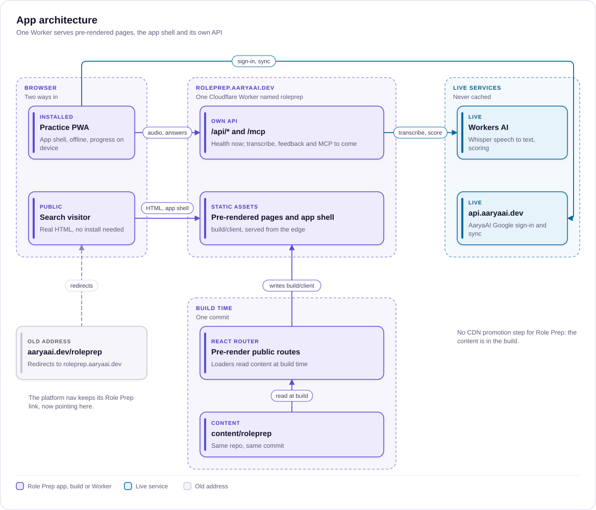
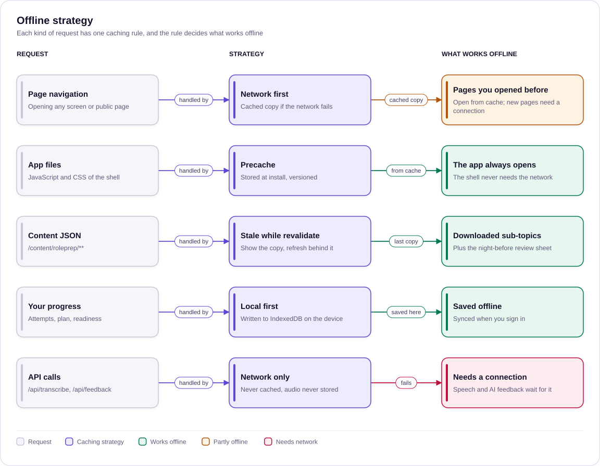

# App architecture

> How the Role Prep app is built, hosted and installed: pre-rendered pages for search plus an installable PWA for practice. For whoever builds, deploys or reviews the app.
>
> Status: Approved · Updated: 2026-11-04 · Owner: Ajeet Chouksey
> Reads after: [05 Repo, brand and agent kit plan](05-repo-brand-agent-kit-plan.md)

## Decision summary

On 2026-11-04 the owner decided nine things. Each is recorded here with its reasoning in the sections below.

| # | Decision | Section |
| --- | --- | --- |
| 1 | Role Prep is its own app, not a feature inside `ajch_platform` | [Why a separate app](#why-a-separate-app) |
| 2 | Build is a hybrid: pre-rendered HTML for public pages plus an installable PWA for practice | [Options compared](#options-compared) |
| 3 | Address is roleprep.aaryaai.dev; aaryaai.dev/roleprep redirects there | [Why a separate app](#why-a-separate-app) |
| 4 | Practice works signed out and saves on the device; signing in with the existing AaryaAI Google sign-in syncs progress | [Accounts and sync](#accounts-and-sync) |
| 5 | Code lives in `ajch_role_prep/app/`, next to `content/` and the kit | [Why a separate app](#why-a-separate-app) |
| 6 | Stack: React 19, Vite 8, Tailwind 4, React Router 7.18 in framework mode, vite-plugin-pwa, TypeScript 6 | [Architecture](#architecture) |
| 7 | Hosting: one Cloudflare Worker named `roleprep` serving static assets and its own `/api/*` | [Hosting and deploy](#hosting-and-deploy) |
| 8 | Offline: precache the shell, network-first navigations, stale-while-revalidate content, progress in IndexedDB | [Offline and install](#offline-and-install) |
| 9 | Rollout in four steps, from scaffold to retiring the legacy pages | [Rollout](#rollout) |

## Why a separate app

Role Prep is its own app at roleprep.aaryaai.dev, built in `ajch_role_prep/app/`, and not a feature inside `ajch_platform`. The reasons:

- **One commit ships content and app.** The authoring kit, the content and the app that reads it live in one repo. The CDN promotion step that [05](05-repo-brand-agent-kit-plan.md#target-architecture) planned (promote workflow, pinned commit, jsDelivr) is no longer needed for Role Prep.
- **Its own install scope.** A subdomain is its own origin, so the app gets its own service worker, its own manifest and its own "Add to Home Screen" identity. Inside aaryaai.dev, one service worker would have to serve every vertical.
- **The daily habit needs an app.** [The journey](02-use-cases.md) is a short practice most days, on a phone, sometimes offline. That is a PWA's job, and a platform-wide PWA is a much bigger decision than a Role Prep one.
- **Same stack, same people.** The stack matches `ajch_platform`, so the kit's engineer agents already know it, and the brand arrives through the same package.

The address follows from that. aaryaai.dev/roleprep redirects to roleprep.aaryaai.dev. The platform nav keeps its "Role Prep" link, now pointing to the new address. The legacy job-ad pack pages in `ajch_platform` retire (see [What changes elsewhere](#what-changes-elsewhere)).

## Options compared

The build question is how a page reaches the learner. Three options were compared.

| Option | Strengths | Weaknesses | Effort |
| --- | --- | --- | --- |
| Static site only | Best search; lowest effort | No install, no offline, no push reminders; page reloads between practice screens. It can't deliver the daily installed experience the journey needs | Lowest |
| PWA single-page app only | Install, offline, push, smooth app feel | Weak for search: crawlers see an empty shell, which hurts the search traffic the business case relies on | Medium |
| **Hybrid (chosen)** | Real HTML for public pages and the full app experience; same hosting cost | One build has to do two jobs: pre-render public routes and serve the app shell for the rest | Medium |

Caveats that apply whichever option is chosen:

- iPhone push notifications only work for installed PWAs (iOS 16.4 and later).
- Safari can clear stored data for sites unused for a while, so signed-in sync matters.
- Microphone capture and AI feedback work in all three options.

The hybrid wins because search is how new candidates arrive and the installed app is how they come back. Neither of the other two options delivers both.

## Architecture

The browser reaches one Cloudflare Worker at roleprep.aaryaai.dev in one of two ways: a search visitor loads a pre-rendered public page, and an installed learner runs the PWA. The Worker serves static assets (the pre-rendered pages and the app shell) and Role Prep's own API. The API calls Workers AI. The installed app calls api.aaryaai.dev directly for sign-in and sync. At build time, React Router pre-renders the public routes from `content/roleprep`, so the content and the app ship from one commit.

*One Worker serves pages, app shell and API; content ships in the build.*

**Stack (decision 6):**

| Layer | Choice | Role |
| --- | --- | --- |
| UI | React 19, Tailwind 4 | Screens and the brand, from the same tokens as the platform |
| Build | Vite 8, TypeScript 6 | One build for pages, shell and Worker |
| Routing and pre-render | React Router 7.18, framework mode, `ssr: false` | Public routes are pre-rendered at build time; loaders run then and read `content/roleprep` directly |
| PWA | vite-plugin-pwa (Workbox) | Service worker and web app manifest |

With `ssr: false` there is no server rendering at request time. Public pages are plain files; everything else is the app shell, which renders in the browser.

## Routes and rendering

Public routes are pre-rendered so crawlers and first-time visitors get real HTML. Everything that depends on the learner (plan, progress, practice state) renders in the app shell, from data on the device.

The routes below take the screens from [04](04-ux-ui-plan.md#screen-inventory) and drop the `/roleprep` prefix, which the subdomain makes redundant. The paths are proposals; the rendering column is the decision.

| Route | Screen | Rendering | Offline |
| --- | --- | --- | --- |
| `/` | S1 Role Prep home | Pre-rendered | Yes, once visited |
| `/topics` | S4 Topics (catalogue) | Pre-rendered; readiness filled in on the device | Yes, once visited |
| `/topics/:topic` | Topic page (sub-topics of one topic) | Pre-rendered | Yes, once visited |
| `/topics/:topic/:subtopic` | S12 Public sub-topic page | Pre-rendered, for search | Yes, once visited |
| `/own-ai` | S9 Practise with your own AI | Pre-rendered | Yes, once visited |
| `/setup` | S2 Setup | App shell | Yes |
| `/today` | S3 Today | App shell | Yes |
| `/practice/:topic/:subtopic` | S5 Practice room | App shell | Yes for downloaded sub-topics; AI feedback and transcription need a connection |
| `/mock` | S6 Mock round | App shell | Yes for downloaded sub-topics; scoring needs a connection |
| `/mock/results` | S7 Round results | App shell | Yes, from the device |
| `/review` | S8 Night-before sheet | App shell | Yes, available offline by design |
| `/profile` | S10 Progress and data | App shell | Yes; sync waits for a connection |
| `/pass` | S11 Pass moments | App shell | No, checkout needs a connection |

The topic page (`/topics/:topic`) is not a screen in the inventory today. It is needed for search and for the catalogue to link somewhere; [04](04-ux-ui-plan.md) should gain it when the screen is designed.

## Offline and install

Install is what makes the daily habit work: the app opens from the home screen, reminders can reach the learner on installed iPhones, and the shell loads without a network. Offline is decided per kind of request, so a learner on a train can still practise what they downloaded.

**The strategy (decision 8):**

1. **App shell.** The JavaScript and CSS are precached at install and versioned, so the app always opens.
2. **Navigations.** Network first, with a cached copy if the network fails. Learners see fresh pages online, and pages they opened before offline.
3. **Content JSON** (`/content/roleprep/**`). Stale while revalidate: the cached copy shows at once and refreshes behind it. The night-before review sheet and downloaded sub-topics are available offline.
4. **Progress.** Written to IndexedDB on the device first, and synced when the learner is signed in.
5. **API calls.** Network only, never cached. Transcription and AI feedback need a connection, and audio is never stored.

*Each request type has one caching rule, which decides what works offline.*

Two things the build has to get right. The service worker must not answer a navigation to a pre-rendered public path with the app shell, or search visitors see the wrong page. And the install prompt belongs after the first completed practice, when the learner has seen the value, not on the first visit.

## Accounts and sync

Practice works signed out and saves on the device. Signing in uses the existing AaryaAI Google sign-in at api.aaryaai.dev, so there is one AaryaAI account across verticals, and signing in syncs progress to it.

- **Signed out:** attempts, plan and readiness live in IndexedDB. Nothing leaves the device except the answer text or audio sent for feedback.
- **Signed in:** progress syncs to the account, so a second device or a cleared Safari store does not lose it. This is the answer to the storage caveat in [Options compared](#options-compared).
- **Open question:** how the session reaches roleprep.aaryaai.dev. Either a shared cookie on `.aaryaai.dev`, or a token exchange between the two origins. To settle with the platform's auth owner (see [Risks and open questions](#risks-and-open-questions)).

## API

Role Prep's API is the same Worker that serves the assets, under `/api/*`. The route names replace the `/roleprep/...` routes in [03](03-epic-features-stories.md).

| Route | Status | What it does |
| --- | --- | --- |
| `/api/health` | Now | Reports the Worker is up |
| `/api/transcribe` | To come | Speech to text with Workers AI Whisper; audio is not stored |
| `/api/feedback` | To come | Scores an answer against server-held rubrics, following the [`scoring-contract`](../.claude/skills/scoring-contract/SKILL.md) skill |
| `/mcp` | To come | Read-only MCP server for "practise in your own AI" |

Sign-in and sync are not Role Prep routes: the app calls api.aaryaai.dev for them. Rubrics stay on the server, as RP-4.1 requires, and the browser never receives them.

## Hosting and deploy

One Cloudflare Worker named `roleprep` runs on roleprep.aaryaai.dev. It serves the static assets from `build/client` and handles `/api/*` itself. Hosting cost is the same as a static site, because static asset requests are served from the edge without running Worker code.

Deploying is one step: build, then deploy the Worker with its assets. The content is already in the build, so a content change and an app change ship the same way, from the same commit. There is no promotion workflow and no pinned manifest for Role Prep.

## What changes elsewhere

**`ajch_platform`.**

- aaryaai.dev/roleprep redirects to roleprep.aaryaai.dev.
- The nav keeps its "Role Prep" link, pointing to the new address.
- The legacy job-ad pack pages (`src/features/interview` and its `/roleprep/:roleId` and `/roleprep/q/:id` routes) retire, along with `public/content/interviews/` and the legacy engineer agent, as [05](05-repo-brand-agent-kit-plan.md) already planned for cutover.

**The plan in [05](05-repo-brand-agent-kit-plan.md).**

- Phases 0 to 2 (foundations, repo and kit, content) stand.
- Phase 3 (platform wiring) and phase 4 (cutover) are replaced by the [Rollout](#rollout) below. The "Changes in ajch_platform" table is superseded: no `roleprep` entry in `promote-content.yml`, `content-manifest.json` or the content loader, no `src/features/roleprep` in the platform, no Worker routes in `workers/`.
- Plugin packaging (phase 5) is unchanged.

**The epic in [03](03-epic-features-stories.md) and the UX plan in [04](04-ux-ui-plan.md).** Stories that referred to `ajch_platform` map as follows. Their acceptance criteria are otherwise unchanged.

| Story | Was | Now |
| --- | --- | --- |
| RP-3.2 | `POST /roleprep/transcribe` on the `aarya-subscribe` Worker's AI binding | `POST /api/transcribe` on the `roleprep` Worker's AI binding |
| RP-3.4 | Reuse the Mentor's burst, daily and global limit pattern | Same limits, implemented in the `roleprep` Worker (see open questions) |
| RP-4.1 | `POST /roleprep/feedback` | `POST /api/feedback` |
| RP-5.5 | Plan builder in `src/lib` | Plan builder in `app/src/lib` |
| RP-6.1 | Separate Worker `aarya-mcp` on `mcp.aaryaai.dev`, content from the manifest-pinned commit | `/mcp` on the `roleprep` Worker, content from the same commit as the app |
| RP-9.2, RP-9.3 | Entitlement and OAuth on platform Workers | Checks in the `roleprep` Worker, sign-in through api.aaryaai.dev |

The component owners in [04](04-ux-ui-plan.md#component-inventory) name platform roles. For app code the owner is the kit's [`roleprep-frontend-engineer`](../.claude/agents/roleprep-frontend-engineer.md) and [`roleprep-backend-engineer`](../.claude/agents/roleprep-backend-engineer.md), with the Design Systems Engineer for general-purpose primitives.

**The kit.** The `roleprep-engineering` and `scoring-contract` skills still describe the platform as the home of the web app and Worker routes. They need updating by the lead; this doc does not change `.claude/`.

## Risks and open questions

| Risk | Mitigation |
| --- | --- |
| Pre-rendered public pages miss a route or serve the shell to crawlers | Pre-render check in CI: every public route in the table has a built HTML file with real content |
| Service worker serves the app shell for a public path | Exclude pre-rendered paths from the shell fallback; test with the installed app and a fresh visitor |
| iPhone learners who don't install get no push reminders | Offer install after the first practice; in-app "today's plan" is the fallback reminder |
| Safari clears stored data for an unused site | Signed-in sync; a "sign in to keep your progress" prompt after the first week of use |
| Role Prep drifts from the platform's brand or auth | Same brand package and stack; auth only through api.aaryaai.dev |
| Free AI allowance is shared with the platform's Mentor | Role Prep's Worker gets its own limits and its own Workers AI binding; confirm quotas before RP-3.4 |

**Open questions:**

- [ ] **How the session reaches roleprep.aaryaai.dev:** a shared cookie on `.aaryaai.dev` or a token exchange. To settle with the platform's auth owner before sync is built.
- [x] **Route paths:** settled by the scaffold (2026-11-04): no `/roleprep` prefix on the subdomain; public pages under `/topics/` (one hierarchy for search, including `/topics/:topic`); practice under `/practice/:topic/:subtopic`, so no catch-all route sits at the root. [04](04-ux-ui-plan.md)'s screen inventory still lists the old paths.
- [ ] **Rate limits in the new Worker:** the Mentor's limit pattern lives in the platform. Decide whether to copy it or call a shared limiter.

## Rollout

1. **Scaffold `app/`** with the PWA shell and one pre-rendered sub-topic page. This is being built now.
2. **Preview deploy** to roleprep.aaryaai.dev, so the install, offline and search behaviour can be checked on real devices.
3. **Build the epic's phase 1 stories** in `app/`, starting with the practice loop, then speak-your-answer and AI feedback.
4. **Redirect and retire:** redirect aaryaai.dev/roleprep to roleprep.aaryaai.dev and retire the legacy pages in the platform.

Done when: the old address redirects, the platform has no Role Prep code or content left, and a learner can install the app and practise one sub-topic offline.
